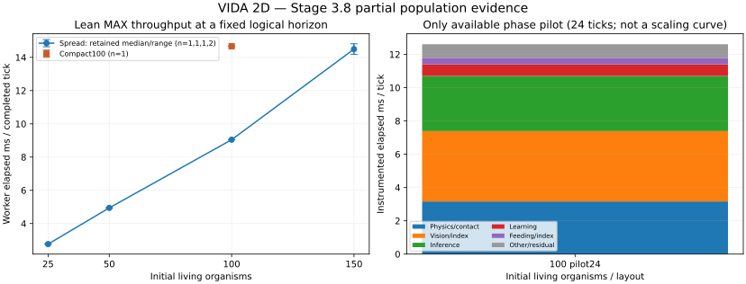

# Stage 3.8 — Large-population scalability: PARTIAL, STOPPED

**Six valid primary windows; seventh attempt failed during raw preservation; eleven slots not started. No rerun or optimization. Stage3.8 is INCOMPLETE.**

The retained observations quantify a substantial loss of Worker capacity as total ecosystem load grows. They do not establish an asymptotic complexity class or a complete subsystem scaling curve. Only150spread has its planned second repetition. The archive budget, rather than a simulation error or time budget, stopped this lot.

## Actual outcome and main observations

All six retained windows executed exactly120 authoritative1/60s ticks from their archived original fixture. Living populations stayed25/50/100/150 as targeted; no completed death, new offspring, egg or guard event occurred in spread fixtures. Compact100 retained its population but recorded eight numerical guard events. Guards remain unchanged and are not hidden.

| Fixture | Retained windows | Living target / actual | Parts / joints | Eyes / rays per tick | Initial → final food | Worker ms/tick | Actual ticks/s | Effective capacity ×1 |
| --- | --- | --- | --- | --- | --- | --- | --- | --- |
| 25 spread | P01, n1 |25 /25 |115 /90 |55 /275 |100 →97 |2.764 |361.77 |6.03 |
| 50 spread | P02, n1 |50 /50 |230 /180 |110 /550 |200 →196 |4.943 |202.29 |3.37 |
| 100 spread | P03, n1 |100 /100 |460 /360 |220 /1100 |400 →396 |9.046 |110.55 |1.84 |
| 150 spread | P04/P06, n2 |150 /150 |690 /540 |330 /1650 |600 →585 |14.175–14.818; median14.496 |67.49–70.55; median69.02 |1.125–1.176 |
| 100 compact | P05, n1 |100 /100 |460 /360 |220 /1100 |400 →394 |14.673 |68.15 |1.14 |

Zero eggs initially/finally in every cell. Hidden neurons are600/1200/2400/3600 for25/50/100/150, with unchanged24-neuron recurrent founders. Five CUR001–005 genotypes appear equally often; part/joint/eye proportions are constant. Full input/output/learning/energy inventories are in [findings.json](findings.json).

From25 to150spread, organism/food/habitat load grows6×, measured elapsed cost grows5.244× and median ticks/s falls80.92%. Per-organism elapsed cost is0.1106,0.0989,0.0905,0.0966ms across those four cells. This finite sparse sequence is compatible with roughly proportional combined workload in these conditions; it does **not demonstrate superlinear growth, O(N), O(N²), a fitted law or a universal saturation population**. The100→150 interval is relatively steeper than earlier intervals; four cells with mostly one observation cannot distinguish a real knee from JIT/host/geometry variation.

The two150spread windows differ4.53% relative to the faster elapsed time. Their entire endpoint snapshots, including PRNG/learning/physics/energy, match exactly. This measures repetition variability at150 only; it is not an error bound for the unreplicated25/50/100/compact cells. A single sample's zero sample spread is not evidence of stability.



## Concentration: large observed contrast, important fixture confound

P05 compact100 costs62.20% more elapsed time/tick than P03 spread100; ticks/s falls38.35%. Habitat4000×2000, original food, organism identities/genomes, velocities, headings, settings, energy budget and PRNG match initially. Only initial body-root positions are compressed to35% of their spread extent around the world center; all segments of each body receive the same translation. This is initialization of a separate fixture, never runtime teleportation.

However, the compressed fixture starts with **68 interorganism intersecting part pairs**, versus zero in spread100. At the final archived pose it has28 versus zero. Both begin with11 nonhinged self-intersections; both end with zero. These are analysis-only SAT counts on archived poses, excluding directly hinged neighbors, **not cumulative collision events or solver impulses**. See [static inventory](static-contact-inventory.json) and its [script](../../../scripts/performance-stage38/geometry-audit.py).

Compact100 also ends with eight numerical guards versus zero spread, greater total body travel2871 versus1467px, different acquired state, and394 versus396 remaining food. Normal physical repair/contact dynamics, optical crowding, altered trajectories and extra visible drawing can all contribute. The default camera is centered on the world and remains stationary; compact bodies occupy more of its visible area. Main canvas FPS is32.37 versus51.59, which is observer load evidence, not the simulation throughput metric.

Therefore the retained contrast supports investigation of **crowded, initially overlapping configurations**, not a clean causal estimate of ordinary overlap-free density or evidence that contact resolution alone caused the62.20% increase. There is one window per density cell. Do not generalize it to naturally evolved schools or promise an optimization benefit.

## Subsystems: only a short100-body pilot is available

All five planned timed phase slots D01–D05 were **not started**. The following is the separate24tick correctness/calibration pilot at100spread, not a120tick primary window and not a population-scaling comparison. Mean instrumented tick elapsed12.608ms, median10.6, SD10.295, p95=15.3, max55.2ms. Cold/JIT/probe/preemption effects are material. Top-level phase sums close exactly with an explicit residual.

| Exclusive phase group | Pilot elapsed ms/tick | Pilot share |
| --- | ---: | ---: |
| Vision plus sight construction |4.2292 |33.54% |
| Recurrent inference |3.3125 |26.27% |
| Physics / shared contacts |3.1625 |25.08% |
| Motor plus sensory learning |0.6917 |5.49% |
| Feeding plus oral indexes |0.3958 |3.14% |
| Environment, metabolism, reproduction/death, input/organism overhead, observer and residual |0.8167 |6.48% |

Only two ticks carry sampled work counters (ordinals1and17). Their averages are1100rays,14639optical candidates,4697.5food-circle tests,9872body-edge tests,1360index entries,100mouths, four contact passes and100contact candidates per sampled tick. No resolved contact was counted on those two ticks. These are two sampled ticks, not comprehensive per-tick distributions or unique dynamic contacts. Static initial/final intersections cannot fill that missing trajectory history.

The pilot identifies vision, inference and articulated physics as credible work fronts at100, consistent qualitatively with earlier studies. It does **not show which share grows fastest at150 or compact100**. Original3.7b phase shares43.86%physics/31.72%vision/13.54%inference must not be transplanted here: host, anatomy, density, food, warmup and horizons differ. No timed overhead O01, trace T01/T02, per-subsystem allocation or lifetime entity-maintenance comparison was reached.

## Capacity, Worker/UI and memory

Measured MAX capacity is actual ticks/s divided by60. At150spread it is only~1.15×; at100compact~1.14×, leaving little throughput headroom on this runner. Both remain above60ticks/s in the short retained windows. The exact point at which1× fails was **not reached or measured**. Sustained pacing at1/2/5/10/20× was not tested; capacity below a requested rate is an arithmetic warning, not a verified paced-speed experiment. Do not extrapolate a200body threshold or desktop result.

The actual production Worker pump,30/s frame cap and one-in-flight ACK contract remain. Observed report rates across retained windows are16.31–19.35/s; observer FPS32.37–54.27 is a different measure. No frequency ablation or separate serialization/deserialization/component timer was executed. Payloads and cross-thread traffic remain in original receipts; exact export is authoritative. Off-camera simulation continues normally.

Linux process CPU brackets include the return and handling of the full endpoint snapshot, outside the precise Worker tick boundary. Their excess bracket width is746–3569ms, exceeding or comparable to the0.332–1.778s useful windows. Thus the recorded19.67–91.92browserCPU-ms/tick values are **not a clean CPU cost per simulation tick** and are not used to rank kernel work. The data remain for audit rather than being silently discarded.

Main-thread `performance.memory` reports the same coarse47.4MB used/123MB total in every retained window. It is neither a Worker heap measurement nor a credible population-memory scaling curve. T01/T02 were not started: Worker GC, transient allocation ownership, retained heap and leak behavior are UNKNOWN. Archive growth documents duplicated serialized evidence, not live-heap growth or a simulator leak.

## Registered design, environment and fidelity

[Preregistration](preregistration.md) was posted in [upstream #57](https://github.com/smeagol44/vidAI/issues/57#issuecomment-6622100948) before coding/execution, with shared [#67](https://github.com/smeagol44/vidAI/issues/67), and isolated fork [DRAFT PR98](https://github.com/hernansgarro/vidAI/pull/98).

- Base fork/main `dd7925b9d02a67459bb68985cf2d5647b737247e`; measured source `f2e5e936f63eb0ca2f366a997abcacbd38460208`; immutable original-evidence commit `9c00d5497db3b351ada3230a4c2b835c79d0abcc`. Upstream reference `041362eefa64971d9038f4ad7ec4fd59a747d3ec`; testing `4bda30a269bd8650b6e12a99b99e4af5ef673d42`.
- Target25/50/100/150, replacing suggested200 because unmodified snapshot validation limits maxOrganisms settings to150. All fixtures retain maxOrganisms150; no validation or computational cap bypass. Largest case690parts is4.26× the previous162part checkpoint, but does not meet a1000part ambition.
- One/two/four/six25body tiles in2000×1000,4000×1000,4000×2000,4000×3000 habitats. Four ordinary3000J plant nutrients per organism; seed73; normal current CUR001–005 genomes/reserves; passive-work-v3, capsule-v1, closed-v1, current decay-v2, viscosity.18, gravity0, inflow0, normal funded ecology/learning. No top-ups, age edits, dummies, artificial propulsion or physics changes.
- Population, food and habitat co-scale at constant expected density. Spatially seeded food, normalized depth inputs, boundary geometry, resulting movement and visible camera contents can still differ. The assay estimates combined ecosystem load, not a pure organism-count coefficient. Founder proportions are controlled; there is no naturally evolved-population contrast or reproduction/hatching workload in this two-simulated-second horizon.
- Actual GitHub Actions Linux runner AMD EPYC9V45 96-Core Processor, four reported CPUs; Node24.22.1; Chromium145.0.7632.6/Playwright1.58.2 official image.1280×850/DPR1, MAX, causticsOFF, no selection/track/inspector. Actual graphics backend is ANGLE_SWIFTSHADER (software Vulkan/SwANGLE), not a physical desktopGPU. Browser command line, cgroup and source digests are archived; no thermal/watts/desktopGPU claim.
- A24tick warmup precedes exact fixture reset for each measured slot. Every retained measurement uses120ticks; no60tick pilot fallback was needed. Source-only Vite transforms reuse3.7b helpers locked to all-real. The common tick-completion guard and tiny final-boundary check exist in both builds; their independent cost is not priced. Ordinary production sources import none of these probes.

## Failure, budget and archive integrity

[Scientific run41770391294](https://github.com/hernansgarro/vidAI/actions/runs/41770391294), job126378485652, **FAILED**. Setup npmci,385fast tests,typecheck/build and actual productionWorker passed. Pilots/counter checks and P01–P06 passed; P07 executed but its full original object exceeded the remaining raw archive budget. It has no retained original/validated endpoint and **no usable rate**. P08–P10,D01–D05,O01,T01–T02 were not started. No result is reconstructed, imputed or replaced.

The design underestimated repeated full-genome/state/lineage JSON size. Guard rejected the next archive under the registered192MiB cap. Retained gzip contents total191,912,261uncompressed bytes (~183.02MiB), including the final manifest; active59.525s, inclusive runner267.048s, seven timed attempts, all within the registered360s/720s/192MiB/18slot ceilings. The failure is budget exhaustion on the next proposed write, not an exceeded retained-byte total or simulation slowdown.

The exception path tried to archive P07 again through the same full-payload budget guard, so neither its pending original nor a dedicated failure archive was retained. The final manifest/ledger/summary and canonical job log do retain the failure and slot status. This preservation weakness is explicitly disclosed; the minimal manifest survived. Do not claim complete failed-window recovery. A future protocol needs reserved emergency metadata capacity and lossless content-addressed deduplication of unchanged genome records; never delete old evidence or modify saved-product semantics to fit the budget.

All35receipt-listed gzip archives plus manifest,ledger,summary and preregistration (39original files) match independently fetched immutable remote Git blobs, SHA256 and lengths. All276inherited base files remain byte-identical. See [verification](verification.json), [remote source equivalence](source-equivalence.json) and [derived scientific log excerpt](scientific-run-excerpt.log). Original full JS/maps and fixture states are preserved, not regenerated.

Counter checks independently prove seven completed ticks despite draining frame deltas4and3.100body lean/research-off/phase24tick snapshots match completely, state hash `38417a1efbd76ee958c2f1f4f48c2b4cc2769136fb70d72f2dfc7921580608a3`;150body120tick repeated endpoints match exactly. Every retained start hash, settings, tick equation and closed-energy check passes; largest world-energy error~6.6e-9J. No numerical guard or physical baseline was changed to produce a favorable result.

## Evidence-backed hypotheses, uncertainty and future risks

| Hypothesis / potential future study | Supporting observation | Remaining uncertainty | Behavior risk to preserve |
| --- | --- | --- | --- |
| Ordered optical index/query/geometry allocation deserves profiling |100pilot vision+sight4.229ms;14639candidates/1100rays on two sampled ticks |No150/density phase curve or per-allocation stack; avoidable cost unknown |Candidate order, RGB/occlusion, rays, learning and exact continuation |
| Shared contacts/hinge repair may amplify crowded-load cost |Compact starts68external intersections, ends28,8guards and+62.20%elapsed |Initial overlap shock, drawing, sensing and trajectories all confound; no dynamic contact ledger |No removed iterations/substeps, altered impulse ordering, propulsion or guard weakening |
| Recurrent evaluation is a substantial large-fixture work source |100pilot inference3.313ms,24hidden neurons/body and proportional layouts |Cold noisy pilot; no steady-state per-size inference curve or measured layout optimization |Existing gene/output/recurrence/learned-weight and energy meanings |
| Entity/observer scans or transient allocations may become important later |Source retains ordered collection work; endpoint payloads/evidence grow strongly |Observer pilot0.033ms only; no event-rich large-world lookup or WorkerGC attribution |Do not remove truthful events, authoritative state or leak protections based on this assay |
| Worker/UI contention and payload growth may affect concentration |Compact canvasFPS32.37 vs51.59spread; full browser environment is shared |No report-cadence ablation or serialization CPU; CPU brackets include export |Off-camera ticks, epoch/ACK consistency, authoritative exports and observer fidelity |

These are future investigation fronts, not tested optimizations, measured savings or permission for Stage4. No hypothetical speedup is reported as a result.

## Recommended next bounded lot: 3.9 (NOT AUTHORIZED OR STARTED)

First address evidence preservation without changing simulation: deduplicate immutable genomes/lineage by hash in research archives, reserve small failure/manifest capacity, estimate largest checkpoint size before the first scientific slot, and keep original source/failure receipts. Register a new output namespace and finite budget; no silent rerun of P07 or unused slots.

Prioritize a replicated100/150spread and100dense comparison with **nonoverlapping initial placement**, matched logical horizon/warmup and lean/phase controls interleaved. Add separately owned self/external contact candidates and resolution counts, vision candidates, actual per-body/part work and visible render workload. This discriminates contact amplification from optical crowding and browser contention. Preserve the current overlapping case as a separate stress assay rather than relabeling it.

Then select a small marked WorkerCPU/GC/allocation diagnostic and a cadence contrast only if budget permits. Keep authoritative120tick timing distinct from expensive boundary exports, and separately price probe overhead. A sustained finite-speed sweep near60/120ticks/s can test pacing failure instead of extrapolating MAX. Natural/evolved populations, independent morphology/food counts and funded eggs/hatching remain subsequent coverage gaps. No200body/cap change or Stage4 follows automatically.

## Reproduction and project state

Analysis only, with the immutable original files checked out:

```sh
node scripts/performance-stage38/analyze.mjs
python scripts/performance-stage38/geometry-audit.py
python scripts/performance-stage38/plot.py
```

These commands read receipts and static poses; they do not launch or step a simulation. Plotting needs matplotlib. Configurations, exact fixtures, source transforms and reference one-shot YAML are in `scripts/performance-stage38`; original archives remain here at9c00d549. Re-running measurements requires a separately authorized/registered campaign and new namespace, not deletion of existing output.

The temporary scientific workflow is removed after this attempt; reference YAML is retained outside.github. PR98 stays DRAFT/UNMERGED. No fork-main merge is authorized by this task and none is performed. Shared #67 remains In progress, not upstreamDone; final status/results/next action are added to #57/#67. Historical3.1–3.7b data/drafts remain unchanged. No production/runtime/schema, main/testing, Pages/Wiki, upstream PR/code/merge/release or VIDA3D changes. **STOP: Stage3.8 PARTIAL; Stage3 ongoing; no Stage4 or automatic recovery.**
