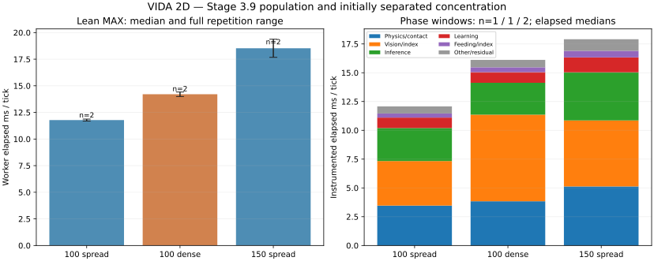

# Stage 3.9 — Population and initially separated concentration: PARTIAL

**Ten attempted scientific windows, all ten retained and numerically verified; eight planned slots were not started. The lot is INCOMPLETE and its global runner-budget audit FAILS. No scientific window was rerun, replaced or lost.**

The new data provide repeated throughput at100/150 and comparable phase attribution, including an initially nonoverlapping dense case. They do not complete the planned overhead, WorkerGC or finite-speed diagnostics. The old Stage3.8 failure remains unchanged.

## Main result: crowding materially increases optical work

Every retained window executes360 complete1/60-second ticks, six simulated seconds. Primary rates are from lean actual-Worker MAX windows; phase diagnostics stay separate.

| Fixture | Primary n / IDs | Actual living / parts / joints | Worker ms/tick, median [range] | Ticks/s, median [range] | Initial → final food |
| --- | --- | --- | --- | --- | --- |
| 100 spread | 2 / P01, P05 | 100 / 460 / 360 | 11.782 [11.692–11.872] | 84.88 [84.23–85.53] | 400 → 378 |
| 100 dense | 2 / P02, P04 | 100 / 460 / 360 | 14.209 [13.999–14.419] | 70.39 [69.35–71.43] | 400 → 385 |
| 150 spread | 2 / P03, P06 | 150 / 690 / 540 | 18.527 [17.678–19.376] | 54.09 [51.61–56.57] | 600 → 569 |

Population, parts and joints stay at target in every retained window; no completed death, new offspring, egg or numerical guard event occurs.100body cases have220eyes/1100rays/2400hidden neurons;150 has330/1650/3600. Same five current CUR001–005 genotypes in equal proportions, normal recurrent learning and funded ecology.

Increasing100spread to150spread increases median elapsed cost57.25%, with50% more bodies/food/habitat. Repetition spans are1.54% at100spread,3.00% at100dense,9.61% at150spread. The observed sequence is compatible with broadly proportional combined ecosystem load; it does not prove superlinear growth or an asymptotic complexity class. Food and area co-scale and behavior differs. With two repetitions and9.61%variation at150, the small excess over proportional growth is unresolved.

At fixed100organisms and identical habitat/food/genes/PRNG/energy, the dense initial layout costs20.60% more elapsed time per tick and achieves17.07% fewer ticks/s. Both dense repetitions are slower than both spread repetitions. This direction is supported within this bounded assay, not an inferred universal density coefficient or optimization speedup.



## Exclusive elapsed phases and observed work

Four phase windows were retained: D01=100spread, D02=100dense, D03/D04=150spread. The second100spread/dense phase repetitions D05/D06 were not started. Each retained diagnostic has360ticks,23sampled work-counter ticks (ordinals1mod16), and exact zero top-level timing-ledger closure error. Times include probes, JIT/GC/preemption and are elapsed measurements, not threadCPU or removable work.

| Exclusive phase group |100spread D01, ms/tick |100dense D02, ms/tick |150spread D03/D04 median, ms/tick |
| --- | ---: | ---: | ---: |
| Vision + sight construction | 3.8675 | 7.5161 | 5.7329 |
| Physics + shared contacts | 3.4661 | 3.8419 | 5.1267 |
| Recurrent inference | 2.8653 | 2.7686 | 4.1769 |
| Motor + sensory learning | 0.9039 | 0.9231 | 1.2926 |
| Feeding + oral indexes | 0.3592 | 0.4197 | 0.5693 |
| Whole measured kernel tick | 12.0767 | 16.1158 | 17.9081 |

Vision+sight share changes32.02%→46.64% for100spread→dense; physics28.70%→23.84%, inference23.73%→17.18%. Physics still rises in absolute time; its lower share is not a speedup. At150spread, vision+sight32.01%, physics28.63%, inference23.32%. Inference and physics each grow about1.46–1.48× for1.5× population, while dense vision+sight costs1.94× its spread counterpart.

The dense-minus-spread phase difference is4.039ms/tick;3.649ms falls in vision+sight (~90% of that diagnostic difference). This is a single instrumented pair's accounting, not90% causal CPU attribution, a calibrated primary effect, or recoverable savings. Primary cost difference is2.427ms/tick in separate lean windows; do not mix those denominators. Dedicated overhead controls were not reached. Phase-window whole-Worker elapsed cost is9.34% above lean reference at100spread,20.79% above at100dense, and roughly2–6% at150; order/host noise and profiling both contribute, so no correction is subtracted.

| Work units per sampled tick |100spread |100dense |150spread |
| --- | ---: | ---: | ---: |
| rays | 1,100.000 | 1,100.000 | 1,650.000 |
| visionCandidates | 14,393.087 | 30,684.130 | 22,604.783 |
| bodyEdgeTests | 10,263.130 | 46,575.652 | 16,416.696 |
| brainEvaluations | 100.000 | 100.000 | 150.000 |
| bodyAdvances | 400.000 | 400.000 | 600.000 |
| partAdvances | 1,840.000 | 1,840.000 | 2,760.000 |
| jointAdvances | 1,440.000 | 1,440.000 | 2,160.000 |
| contactPasses | 13.435 | 16.783 | 13.435 |
| selfContactCandidates | 899.043 | 1,004.348 | 1,311.174 |
| selfResolvedContacts | 330.217 | 306.130 | 477.261 |
| externalContactCandidates | 1.739 | 79.609 | 4.870 |
| externalResolvedContacts | 0.000 | 12.522 | 0.000 |
| activityEntries | 15.565 | 15.957 | 21.109 |

Dense100 performs2.13× optical candidate visits and4.54× body-edge intersection tests with the same1100rays. That direct work-count increase strengthens the optical-crowding hypothesis beyond timing alone. It does not prove that all candidates can safely be omitted: occlusion, source ordering and exact closest-hit geometry remain required.

Contacts also increase: external candidates rise1.74→79.61 and resolved external overlaps0→12.52 per sampled tick; contact passes13.43→16.78. Counts include repeated solver passes and SAT overlaps, not unique encounters or necessarily nonzero impulses. Most counted resolved work in spread worlds is self-contact. Fixed-offset sampling has only23ticks/window; do not invent full-trajectory event totals from it. Activity bookkeeping remains a small observed phase (~0.2–0.3% here); no large-world event-burst allocation cost was isolated.

## Density fidelity, ecology and physical limitations

Initial100spread and100dense share settings, habitat4000×2000, food, identities/genomes, headings, velocities, PRNG and energy budget. Each dense body is translated intact so its full rotated-AABB center occupies a fixed140px10×10 centered grid. Bodies are<=112px and actual minimum body-AABB gap is30.842px. Both begin with ZERO external part intersections; inherited self-intersections are identical. There is no position search based on simulated performance, genetic tuning, scripted motion or runtime relocation.

After six simulated seconds, static SAT finds2external intersecting pairs in dense versus0in spread, with0nonhinged self-intersections. These are final-pose counts, not cumulative collisions. All ten endpoints have zero numerical guard events; dense retains385food versus378spread, and actual reserves, movement, learning and feeding differ normally. The new case avoids Stage3.8's68external initial overlaps and8guard-event confound. It is a different fixture/horizon/host: do not subtract the old62% contrast from the new20.6% and call the difference an overlap cost or an improvement.

Dense placement changes local neighbors, retinal content, normalized depth, distance to walls and visible drawing as part of the spatial condition. Main canvasFPS is~33–34dense versus48–50spread. Thus browser contention can contribute to Worker elapsed time; the independently increased optical work does not isolate every causal pathway. No render/cadence ablation was performed.

Static endpoints show small full-body-AABB wall protrusions in spread cases (left~6.8px at100/~10.2px at150; bottom~3.8/~7.4px), despite initially contained bodies and zero numerical guards. This inherited behavior is retained/disclosed, not solved or hidden by tuning. No mechanical-energy correctness, ecological sustainability or naturally evolved-population benefit is established. No eggs/hatching or mature reproduction were loaded in this six-second assay.

## Capacity, communication and CPU/memory limits

At150spread the two MAX windows achieve51.61–56.57ticks/s, equivalent to0.860–0.943× nominal60Hz simulation. This is direct evidence of insufficient1× throughput capacity in these short MAX conditions on this CI runner. Requested1×/2× pacing probes S01/S02 were not started: actual finite-speed behavior and sustained desktop saturation are unmeasured.100spread has~1.415× measured capacity;100dense~1.173×. ObserverFPS is not simulation throughput.

The original30/s frame cap and one outstanding ACK stay intact. Actual fresh-state reports are14.84–17.46/s across retained windows. In phase windows, median host.frame construction is~0.30ms at100 and~0.40ms at150; median synchronous postMessage call duration is2.0–2.1ms at100 and2.9–3.0ms at150. These component timers are outside tick phase totals. They include synchronous serialization/call delay, not complete receiver deserialization/React/ACK latency, and cannot establish gains from lower cadence. Latest warmed-frame approximate JSON sizes are~0.63–0.66MB at100/~0.95MB at150, not actual structured-clone wire bytes.

Lightweight completion precedes processCPU closure; the expensive full authoritative snapshot is requested afterward. All per-window exports take4.05–7.14seconds in this automation environment and are outside useful Worker timing. CPU-bracket excess is2.70–3.50% for lean windows,4.46–11.12% for phase windows, much smaller than Stage3.8's export-contaminated brackets but still material. GroupCPU35–61CPU-ms/tick sums browser processes, not Worker-only/per-phase CPU. The marked GC/WorkerCPU traces T01/T02 and overhead O01/O02 were not reached. Main performance.memory remains a coarse main-thread signal, not a Workerheap curve, leak proof or allocation ownership. New WorkerGC/allocation data are unavailable.

## Protocol, archive repair and provenance

Preregistered before coding in [#57 comment6622977505](https://github.com/smeagol44/vidAI/issues/57#issuecomment-6622977505), shared [performance issue#67](https://github.com/smeagol44/vidAI/issues/67). Work is isolated in [fork DRAFT PR99](https://github.com/hernansgarro/vidAI/pull/99), branch`audit/performance-stage-3-9`, from fork/main`dd7925b9d02a67459bb68985cf2d5647b737247e`. No upstream PR or production merge.

Original source`ee623a7cb954c842de3fbbdb5cb122eeb0da9cc7` ran finite correctness pilots but ZERO scientific windows: preflight projected223,811,966bytes above192MiB and correctly refused to start. All original preflight outputs remain at`0445603d2d0c348ec602be52284385af8b416452`, directory`performance-stage-3-v11`; artifact13298185326. The protocol permitted plumbing repairs before the first timed slot. [Storage amendment](../performance-stage-3-v11/storage-amendment.md), registered in [#57 comment6623177419](https://github.com/smeagol44/vidAI/issues/57#issuecomment-6623177419), kept all limits and reused those pilots without re-simulation.

Matrix source`4bc35f0198d6997fed06d543d973589d0df87490`; original matrix evidence`f76bb95a764eaf872cbdb63ecef1f889198ccdb2`. Product/runtime source digests and ordinary/lean/profiled Worker binaries match the verified preflight exactly. Genomes are stored once by hash; homogeneous acquired-state records use ordered columns, exact numeric arrays use IEEE754LE/base64, repeated edge identifiers use content-addressed label dictionaries. Every receipt proves exact expanded JSON/order/hash/length reconstruction. This is a research evidence format, not a changed product save or live-heap optimization.

New execution archives use30,474,649normal stored raw bytes plus37,847emergency bytes, representing277,595,764expanded logical bytes including manifest. Combined preflight+execution retained raw/control volume is49,937,497bytes, well below the unchanged storage limits. Dictionaries precede references; originals precede validation. Minimal failure/manifest retention survived independently. No scientific original was lost or repeated. All54matrix original files and23preflight original files match immutable fetched Git blobs; all276inherited base files remain byte-identical. [Source equivalence](source-equivalence.json), [verification](verification.json), [machine-readable findings](findings.json).

Correctness: reused100body lean/off/counter/phase24tick complete snapshots match; cumulative completed counter7 survives drained frame deltas4+3. Actual360tick endpoints match exactly across P01/D01/P05, P02/D02/P04 and P03/D03/D04/P06, including full neural/learning/physics/PRNG/energy state. Every retained tick equation, settings/start hash and energy assertion passes; maximum closed-energy error3.86e-7J. No guard/baseline/acceptance condition was loosened.

## Global budget failure and missing slots

Scientific matrix [run41778306250](https://github.com/hernansgarro/vidAI/actions/runs/41778306250), job126403701405, **FAILED** at the inclusive720s runner guard before D05. Setup npmci, archive/emergency/corruption checks,385fast tests, build and actualproductionWorker passed. All ten started scientific windows were retained once. Eight not started: D05,D06,O01,O02,T01,T02,S01,S02. Artifact13297979535 and Git preservation succeeded.

The initial preflight is charged19.859sactive/138.403srunner. Matrix execution adds127.258sactive/601.524srunner; combined147.117sactive and739.927srunner. I underestimated full-state import/export and evidence-processing time between windows. The cooperative guard stopped the next slot, but post-window processing caused a19.927s total overrun. **The registered runner budget was exceeded; do not label this campaign budget-compliant or complete.** Active/storage/attempt ceilings remain below their limits; the elapsed-budget failure stays explicit.

All useful measurement intervals ended before the deadline. Last P06 ends at approximately715.943charged seconds, with full export/validation/archive afterward. Total useful timed spans are56.751s. The [timing audit](runner-timing-audit.json) documents this alignment; it does not waive the total739.927s failure. No new scientific slot began after the limit. Analysis intentionally exits nonzero for the recorded budget violation while still writing verified numerical findings; a green routine code check does not convert the scientific run to success.

## Evidence-backed hypotheses and next scope

| Future investigation front | Supporting result | Uncertainty / fidelity boundary |
| --- | --- | --- |
| Ordered optical candidate/index/geometry work | Dense:2.13× candidates,4.54× body-edge tests,1.94× vision+sight elapsed; density increases primary cost20.60% | Single phase pair; render contention and real trajectories remain. Preserve all rays/RGB/occlusion/source ordering/learning and exact continuation. No measured safe speedup. |
| Articulated/shared contact work | Physics3.47→3.84ms dense; large self-contact counts; physics~1.48× at1.5×population | Essential work, sampled iterative counts, no standalone cache saving. No fewer solver iterations, altered forces, clamps or artificial propulsion. |
| Recurrent inference/data lifetime |2.87→4.18ms at100→150, proportional evaluation count | Not a demonstrated nonlinear brain bottleneck. Preserve recurrent state, learned weights, genes and paid energy; no disabling brain/learning. |
| Worker transport and allocations |Frame post-call medians~2→3ms as payload grows; WorkerGC still unmeasured | Synchronous timing is not full IPC or an allocation trace; no cadence or payload optimization gain is established. |
| Research harness evidence boundaries |4–7s authoritative exports and repeated large imports outside useful windows exhausted total runner time | Improve the research harness only under a new protocol; do not silently change product saves, original evidence or budget criteria. |

Recommended next bounded lot3.10, **not started or authorized here**: prioritize the eight missing controls with a smaller matrix. First reserve full import/export/archive time and stop before starting a slot that cannot finish; retain failure metadata. A research-only fixture token/cache and lossless compact authoritative export can avoid repeatedly transferring immutable genome data, while reconstructing exactly the same snapshots. Then finish paired100phase replication, priced off/counter overhead, marked WorkerCPU/GC and actual1×/2× pacing. Use a fresh namespace and budget; never replace old results. Additional anatomy/food factors, naturally evolved populations, cadence ablation and eggs remain later gaps. No Stage4 implementation or product optimization follows.

## Reproduce analysis and project state

Use a full Git checkout of this research branch with its original dictionaries. Geometry also needs the existing npm dependencies; plotting needs matplotlib. The [scripts](../../../scripts/performance-stage39/) and [registered protocol](../performance-stage-3-v11/preregistration.md) are retained. Run:

```sh
node scripts/performance-stage39/analyze.mjs
# Expected nonzero exit: recorded global runner budget failed; JSON outputs still written.
node scripts/performance-stage39/timing-audit.mjs
node --import tsx scripts/performance-stage39/geometry-audit.mjs
python scripts/performance-stage39/plot.py
python scripts/performance-stage39/verify-source.py
```

These read archived values/static geometry; they do not step the simulator or rerun a scientific trial. Geometry uses the existing product rectangle-SAT helper; plotting needs matplotlib. Codec-only checks:`node scripts/performance-stage39/test-archive.mjs`. Re-execution of measurement is not authorized by these commands.

Temporary scientific workflow is removed after this lot; original and amended YAML remain outside.github. PR99 stays DRAFT/UNMERGED. Main/testing/upstream heads and all prior evidence remain unchanged by this task. No production runtime/schema/genetic/energy/physics change, Pages/Wiki publication, upstream PR/merge/release or VIDA3D work. Shared#67 remains In progress, not upstreamDone. **STOP: Stage3.9 PARTIAL, Stage3 ongoing; no automatic recovery or Stage4.**
