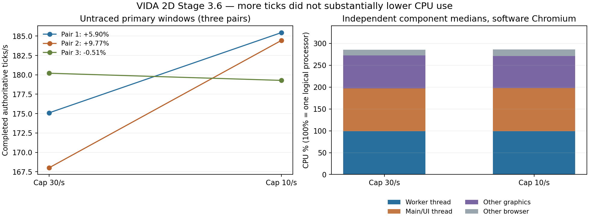

# Stage 3.6 — CPU execution, GC and Worker/UI contention

**Bounded batch COMPLETE; Stage 3 ONGOING; STOP for Hernan review. Research only, unmerged.** No Stage 3.7 or Stage 4 implementation is authorized.

## Executive summary

The simulation Worker is nearly fully CPU-bound, but it is **not the dominant majority of total browser CPU** in this software-rendered environment. At cap 30, medians are **98.73% of one logical processor for the Worker**, **98.39% for the main/UI thread**, and **75.35% for additional graphics threads/processes**. Browser total is **286.71% of one processor**, or **71.68% of four reported host processors**. The Worker accounts for about34.6% of browser CPU; the UI thread about34.3%. Main-thread drawing includes rendering work, so do not add a separate estimate of that same drawing again.

Reducing the research reporting cap 30→10/s changes primary median throughput **175.10→184.43 ticks/s (+5.33%)** and browser CPU cost **16.778→15.527 CPU-ms/tick (-7.46%)**. Paired throughput changes are **+5.90%, +9.77%, −0.51%**. Total processor use barely changes: **286.71→285.05%**. This is an observed efficiency/throughput contrast, **not a demonstrated cooling or substantial CPU-utilization reduction**. The last negative pair and profiler perturbation prevent a stable-gain or complete causal explanation.

Independent thread identities, CPU accounting and GC are now measured. The strongest new opportunities are substantial observer drawing in software Chromium and specific sampled Worker hot paths/allocation churn. Their avoidable fractions remain unknown. The authoritative simulation remains intact, and no permanent optimization was implemented.

## Reproducible specification and provenance

[Preregistered before coding/execution](https://github.com/smeagol44/vidAI/issues/57#issuecomment-6612286201). See [complete protocol](protocol.md), [raw manifest](manifest.json.gz), [raw summary](summary.json), [numerical findings](findings.json), [integrity verification](verification.json), [offline source mapping](source-mapping.json).

- Fork/main base `e7c07734d080964a8ac908c0a8283b4581c4d940`; measured research source `81ce31d81d8ce43a7b47ae2c7c5fba4379915699`; original evidence commit `d530894f668d2b116190102a324b03679649a690`. Upstream main `041362eefa64971d9038f4ad7ec4fd59a747d3ec`; independent testing `4bda30a269bd8650b6e12a99b99e4af5ef673d42`. Production runtime matches Stage 3.5 baseeff9034; intervening fork changes are documentation/instructions only. No newer completed performance batch superseded3.5; the later Worker-hot-path handoff was documentation only. This explicit request selected the CPU/GC follow-up.
- **Exact Stage 3.5 checkpoint reused**, not regenerated: reference commit18e6673, compressed reference SHA256 `c6ab22b6d12f5b38f8234c5a440620218173a31f8ae23fbf4a5ef83a9455758e`, Git blob5bcee1e6. Thirty organisms,162 parts,78 eyes/390 rays,720 hidden neurons,275 food,0 eggs;2400×1500 Default world,seed73. Fixed disconnected topology. All off-camera biology, physics, contacts, senses, learning, feeding, mortality and funded reproduction remain active.
- Production Worker/browser with build-only isolated boundary hooks and matched frame/RAF observers; research cap 30/10 only, same one-frame ACK backpressure and full RenderFrame. MAX, causticsOFF, no selected/tracked organism/inspector,1280×850,DPR1, default camera, no camera input. No per-tick timer in any measured window. Coarse-timer diagnostic build exists in helper history but was not used; diagnostics add CDP tracing to the same lean build.
- Intel Xeon Platinum8370C@2.80GHz,4 reported logical CPUs, Linux7.0.0-1017-azure/x64, Node24.22.1, Playwright1.58.2/Chromium145.0.7632.6. ANGLE/SwiftShader; hardware Vulkan unsupported. Cgroup `cpu.max=max 100000`, memory.max=max: no explicit tighter quota observed; reported CPUs are not a dedicated-host guarantee.
- Twelve windows once: C1/C2 cap 30 untraced/traced4 s; primary caps30,10,10,30,30,10 at20 s; diagnostics10,30,30,10 at10 s. Each has2 s warmup followed by exact checkpoint reimport. No simultaneous application workload. A single120 logical-tick original-host versus actual-Worker cap 30/10 pilot passed full state/settings/PRNG/energy equality. Pilot state SHA256 `cda436436c500639dfb30207caa1d40ce5bc31b7c6b14e219dd1a0594d07870d`, accounted energy1323540.0000000033 J.
- [Scientific CI41695218166](https://github.com/hernansgarro/vidAI/actions/runs/41695218166), job126123869780, **SUCCESS**. Setup readiness82.743 s after explicit setup clock; charged active249.714 s<360; runner372.628 s<600; whole run18:35:09→18:43:30UTC (~8m21 s, container setup/validation/artifact preservation included). Scientific archives80,795,426uncompressed bytes including manifest<128MiB. All12 retained; no scientific failure, lost result, repeat or expanded budget.

## CPU measurement definitions and verified attribution

Linux `/proc/PID/stat` process totals and `/proc/PID/task/TID/stat` user/system counters, at100clock ticks/s, are actual accumulated CPU execution. `/proc/.../schedstat` adds runtime and runqueue waiting; context-switch counts are retained. Browser SystemInfo provides process roles and independent process CPU readings. The browser group is the browser PID and descendants; Node/controller, build and test processes are excluded. Total process CPU retains contributions of threads that exit; per-thread sums are corroborative and must not be added to process totals. No process starts/exits occurred in measured brackets; unmatched/zero-CPU threads are disclosed in raw snapshots.

Explicit user-timing marks in **all five traces** independently identify Worker **PID1358/TID1377**, main **PID1358/TID1358**. `/proc` starttime/lifetime matches through all12windows, including untraced primaries. Merely naming a thread DedicatedWorker was not the attribution method. No trace reported data loss. Non-UI graphics totals include GPU-role processes and named compositor/raster/Viz threads; they exclude UI/main CPU already counted separately. Shared ThreadPool/GC work cannot all be assigned uniquely to Worker versus UI.

**100% means one logical processor.** Four-core host-normalized percentages divide browser total by4; they are not Task Manager readings on Hernan's computer. Worker/main CPU percentages use the outer OS-snapshot interval. Primary outer brackets exceed actual Worker tick intervals by36.8–159.8 ms over~20 s (0.18–0.80%); OS reads take6.3–14.5 ms total per primary. CPU-ms/tick is **inclusive browser/Worker cost over that surrounding bracket**, not a precisely isolated kernel-only coefficient. Quantization and boundary/control overhead remain; no subtraction or invented precision correction was applied.

| Component, independent medians | Cap30 | Cap10 | Interpretation |
| --- | ---: | ---: | --- |
| Worker thread CPU, one-core % |98.73|99.35|~one busy processor on average; not proof of saturation at every instant |
| Main/UI thread CPU, one-core % |98.39|98.05|Nearly another busy processor despite fewer state reports |
| Additional graphics CPU, one-core % |75.35|73.69|Software raster/compositing/GPU-process work, not hardware GPU utilization |
| Browser group CPU, one-core % |286.71|285.05|~2.85–2.87 logical processors; medians above need not sum exactly |
| Browser group / four reported CPUs |71.68%|71.26%|Shared-host capacity normalization only |
| Worker CPU-ms / tick |5.623|5.383|Observed median−4.27%; includes Worker overhead/GC |
| Main CPU-ms / completed Worker tick |5.592|5.329|Observed−4.70%; normalization by useful simulation progress |
| Browser CPU-ms / tick |16.778|15.527|Observed−7.46%; no watts/temperature inference |

## Throughput, traffic, responsiveness and variation

| Window | Cap/s | Ticks | Ticks/s | Worker CPU% | Main CPU% | Browser CPU% | Browser CPU-ms/tick | Canvas FPS | Reports/s |
| --- | ---: | ---: | ---: | ---: | ---: | ---: | ---: | ---: | ---: |
| P01 | 30 | 3507 | 175.10 | 98.12 | 97.57 | 292.77 | 16.778 | 48.93 | 19.52 |
| P02 | 10 | 3713 | 185.44 | 99.35 | 97.91 | 285.05 | 15.400 | 51.34 | 8.49 |
| P03 | 10 | 3693 | 184.43 | 99.05 | 98.05 | 285.69 | 15.527 | 50.84 | 8.44 |
| P04 | 30 | 3362 | 168.02 | 99.09 | 98.39 | 286.71 | 17.127 | 54.37 | 19.64 |
| P05 | 30 | 3609 | 180.21 | 98.73 | 98.98 | 284.29 | 15.902 | 52.03 | 19.92 |
| P06 | 10 | 3590 | 179.28 | 99.37 | 98.17 | 284.41 | 15.914 | 53.94 | 8.49 |

| Adjacent comparison, original order retained | TPS cap 10 vs30 | Browser CPU/tick | Worker CPU/tick |
| --- | ---: | ---: | ---: |
| P01 / P02 | +5.90% | -8.21% | -4.54% |
| P03 / P04 | +9.77% | -9.34% | -9.05% |
| P05 / P06 | -0.51% | +0.07% | +0.68% |

Median TPS ranges: cap 30 **175.10[168.02,180.21]**, cap 10 **184.43[179.28,185.44]**, n=3each. Achieved simulated-time multipliers2.918→3.074x; requested MAX is not this measured progress. Report medians19.64→8.49/s, Canvas52.03→51.34 FPS. Redraws per fresh state therefore rise from roughly2.65to6.05; those redraws may still animate truthful transient presentation and cannot all be declared useless identical pixels. Send-start→main-receipt medians across primary windows9.4–12.9 ms, p95~21.7–26.2 ms; these include synchronous clone/enqueue and dispatch, not pure wire latency. Fresh-state spacing grows~51→118 ms, independently of dispatch latency/FPS. Input-to-visible-state latency and subjective smoothness were not measured.

Primary RAF p95~33.3–33.4 ms; p99~33.4 ms exceptP01at50 ms. P01 recorded two long tasks, max54 ms; the other five primary windows recorded none. This is a limited responsiveness guardrail, not human input acceptance. The main thread remains CPU-saturated on average.

All primary endpoints have29 living/156 parts/75 eyes/696 hidden neurons, one completed death, zero births/eggs,280–281 food; full transient birth/death counters are now recorded. Diagnostics stop earlier in simulated time and have no births/deaths. Final accounted-energy deviation from1323540 J stays below8.6e−8 J. Equal-wall endpoints legitimately differ because tick counts differ; different ecological horizons are a residual confound for per-tick averages. No save/PRNG/energy baseline was changed.

The short control changes170.29→160.44 TPS (**−5.78%**) and45.11→38.74 FPS (**−14.12%**) when tracing is enabled. It is one ordered pair, not an overhead confidence bound. Four diagnostic TPS values164.11/167.70/173.12/146.09 are lower and yield cap 10 paired effects−2.14%/−15.61%, opposite the primary median trend. **The profiler materially perturbs the system.** Do not pool diagnostics with primaries, subtract the short-control percentage as a correction, or treat profiled GC/stack differences as the primary causal mediation estimate. The matched observer wrappers' absolute zero overhead is not established.

## GC, allocation and memory

Diagnostic trace times are aligned to the actual Worker begin/end using the explicit Worker mark's trace timestamp and local startTime. GC wall intervals are clipped to those boundaries and unioned per thread to avoid nested-event double counting. GC thread execution uses unioned `tts/tdur` intervals wholly inside the boundary, omitting crossing events rather than guessing partial CPU. Event-duration percentiles below use fully contained top-level MinorGC/MajorGC pauses, not all nested subphase events.

| Diagnostic / cap | Thread | Minor / major pauses | GC union wall ms | GC union thread CPU ms | Pause median / p95 / max ms | V8 allocation proxy MB/s |
| --- | --- | ---: | ---: | ---: | ---: | ---: |
| D01 / 10 | main | 3 / 2 | 52.289 | 41.097 | 6.532 / 7.561 / 14.373 | 13.17 |
| D01 / 10 | worker | 132 / 10 | 252.826 | 183.828 | 1.488 / 2.554 / 6.910 | 435.18 |
| D02 / 30 | main | 5 / 2 | 81.509 | 62.755 | 9.144 / 12.614 / 15.779 | 18.00 |
| D02 / 30 | worker | 136 / 10 | 259.121 | 188.753 | 1.530 / 4.308 / 6.671 | 444.20 |
| D03 / 30 | worker | 139 / 11 | 268.780 | 205.069 | 1.476 / 3.061 / 8.041 | 459.93 |
| D03 / 30 | main | 4 / 4 | 100.588 | 84.463 | 7.614 / 10.389 / 11.798 | 18.91 |
| D04 / 10 | main | 4 / 2 | 75.908 | 45.602 | 8.138 / 10.340 / 14.027 | 11.91 |
| D04 / 10 | worker | 116 / 10 | 237.633 | 161.277 | 1.582 / 2.673 / 6.408 | 362.17 |

Across the two diagnostics/cap, Worker GC wall medians263.95→245.23 ms (~2.6→2.4% of10 s), thread CPU196.91→172.55 ms (~1.6–2.1% of measured Worker CPU per diagnostic). Main GC wall91.05→64.10 ms and thread CPU73.61→43.35 ms. Worker GC wall per completed tick is approximately0.154→0.158 ms: lower absolute GC at cap 10 **does not establish less Worker GC per unit of useful work**. Background parallel GC CPU is present on shared threads and is not all assigned to these mutator totals.

V8 `GCTraceGCNVP` directly records `allocated` and heap-before/after values. The allocation proxy sums V8-reported bytes between complete consecutive GC-log boundaries, excluding first/last partial mutator intervals; it is neither heap-size change nor exact process allocation traffic. Worker diagnostic rates362–460 MB/s (~2.48–2.66 MB per normalized completed tick); main11.9–18.9 MB/s at the long diagnostics. Main cap 10 median12.54 MB/s versus18.46at30 suggests less UI allocation pressure; Worker399versus452 MB/s also co-varies with slower profiled tick progress. No allocation stack, per-state-report allocation spike, retained-heap leak or long-run memory-pressure mechanism is established. Main boundary heap deltas are preserved but not used as GC proof. V8's "allocation failure" GC reason denotes its collection trigger; this is not evidence of OS out-of-memory.

## Sampled execution locations and what they mean

In the four long diagnostics, main-thread `drawImage` accounts for **74.40–77.47% of weighted sampled intervals**; the dominant stack includes **draw → WorldSceneLayer.finish → drawImage** (~73.8% inD01). This locates expensive presentation work in software Chromium. Samples can include native/deferred rasterization, submission, waiting and preemption: **they are not pure-copy CPU measurements**, and they cannot price a hardware-GPU desktop improvement.

CPU-profile chunks are emitted on profiler helper threads; they were linked by `(PID, profile id)` to the original `Profile` event's owning main/Worker TID, rather than misattributed to those helpers. Weights use sampled intervals clipped to the same boundaries and include idle/native/preemption, so the percentages below are **sampled-location evidence, not OS CPU shares or removable budgets**. Hidden-source-map reconstruction emits the same content-hash asset filenames seen in the traces; Worker JS SHA25685406dba9a283f16d34d083269454784898326ea26680c9b828d5997adcc4329 matches the separately generated lean asset byte-for-byte. Source map/digests/method are in source-mapping.json. The original CI HTTP response-body hash was not captured; reconstruction is not presented as a preserved original response body.

RepresentativeD01Worker sampled leaves:

| Location | Unchanged source module/line | Sampled interval share |
| --- | --- | ---: |
| `getCardinalAnchor` | `simulation.ts:988` | 15.14% |
| `stepSimulation` | `simulation.ts:3579` | 13.25% |
| `query` | `spatialIndex.ts:42` | 12.07% |
| `writeDeltas` | `neuralRuntime.ts:108` | 11.45% |
| `pairs` | `contacts.ts:119` | 8.79% |
| `bodies` | `contacts.ts:84` | 6.53% |
| `advanceOrganismPhysics` | `simulation.ts:3002` | 5.63% |
| `rotatedContact` | `contacts.ts:21` | 3.98% |
| `resolveBodyContacts` | `contacts.ts:149` | 3.12% |

D02–D04 also show cardinal anchors~14.6–14.8%, spatial queries~12.1–12.4%, somatic `writeDeltas`~11.1–12.1%, contact pairs~8.4–8.5%. Existing neural compilation/delta buffers and contact wrapper/cell reuse are already in source. These samples motivate a **new separately authorized phase/allocation study**, not immediate cache replacement, learning reduction, solver simplification or removal of safeguards. Inlining/JIT and caller work complicate exact per-function interpretations.

## Why reporting cadence might help: ranked mechanism register

| Rank / stable IDs | Mechanism | Classification and confidence | What remains unresolved |
| --- | --- | --- | --- |
|1 / S2-12,S2-11|Worker~99%one core **and** UI~98%plus graphics~74–75%|**CONFIRMED, high** for this software-CI fixture|Which presentation work is avoidable without changing visual truth; hardware-GPU applicability |
|2 / S2-09|Cap reduction raises useful progress / browser CPU efficiency|**PLAUSIBLE, moderate**: medianTPS+5.33%, CPU/tick−7.46%, but one paired sign negative|Stable gain, exact mediation, ecology/JIT/shared-host variation |
|3 / S2-03,S2-05,S2-01/02|Queries, anchor geometry, somatic delta preparation and contacts are real sampled hot locations|**CONFIRMED sampled activity; avoidable portion UNKNOWN**|Exact call/phase/allocation counts and gains under unchanged simulation |
|4 / S2-12-M|Substantial transient allocation and actual GC|**CONFIRMED in diagnostics**, not just heap deltas|Allocation stack ownership, retention, long-run burden; lower reporting is not shown to reduce WorkerGC/tick |
|5 / S2-12|Worker scheduler waiting explains the whole cadence benefit|**NOT SUPPORTED as sole explanation; weakly plausible partial effect**|Primary Worker waits79–273 ms at30 and49–115 ms at10 over~20 s. Wait fractions~0.24–1.36%; pair2 improvesTPS despite cap 10 having greater wait. Involuntary switches do not identify their competing cause |
|6 / S2-09|Lower main CPU or graphics CPU alone explains the gain|**NOT ESTABLISHED**|UICPU medians98.39→98.05; graphics75.35→73.69, mixed pairs. Both remain expensive; no causal mediator isolation |
|7 / S2-09|GC reduction alone explains primary gain|**NOT ESTABLISHED**|Diagnostics are materially perturbed; WorkerGC/tick does not improve consistently. Clone/deserialization/queue effects not individually CPU-priced |
|8 / S2-12|Fewer reports necessarily lower Canvas FPS or substantially lower total CPU|**REFUTED IN TESTED SCOPE**|FPS medians essentially unchanged; totalCPU−0.58%relative, without a precision bound |
|9 / S2-12-M|Heap growth proves a leak, OS memory pressure, thermal throttling or watts saved|**UNRESOLVED / no supporting measurement**|No controlled retention, allocation stacks, sensors, frequency/energy telemetry or desktop data |
|10 / S2-08|Connected tubes/crossings dominate current fixture|**UNTESTED**, fixed disconnected topology|No tube campaign; preserve prior uncertainty |

The evidence supports **a combination of useful authoritative computation and large observer/graphics overhead**, with possible transport/allocation/scheduling interactions. It does not justify saying that all Worker CPU is useful, all UI CPU is unnecessary, or that UI contention is the sole cause. Cache/bandwidth contention, pure serialization/deserialization CPU and exact scheduling competitors remain UNKNOWN.

## Comparison with Stage 3.5

Stage 3.5's30-organism cap contrast230.10→243.39 TPS(+5.78%; pairs+3.58/+8.13%) remains immutable. Stage 3.6 observes a similar median direction175.10→184.43(+5.33%) but one negative pair. Absolute TPS and52 FPS versus prior~60 FPS **are not regressions/speedups across studies**: CPU model, diagnostics design, primary duration20vs10 s, JIT/trajectory and host conditions differ. The starting checkpoint and production runtime are the same. New evidence replaces only prior UNKNOWN CPU/GC attribution for this fixture; it does not rewrite3.5 or generalize its15-organism−0.99% result.

Stage 3.5's96–98%Worker **wall-time** tick share never meant96–98%of browser CPU. Verified group/thread accounting now shows the Worker around35%of total browser CPU. The old postMessage wall reduction still does not explain the entire throughput movement; this batch narrows alternatives but does not close that causal question.

## Heating, options and next research recommendation

No physical temperature, package power, watts, energy/tick, processor-frequency throttling or user-hardware stress was measured. Sustained near-core saturation in both Worker and UI plus software graphics is relevant to the heating motivation, but it cannot quantify temperatures or prove desktop overheating. Lower cap 10 **keeps nearly the same processor consumption** while advancing more ticks in two pairs: potential CPU efficiency, not demonstrated thermal relief. A resource cap that proportionally reduces useful work is a throughput/comfort trade-off, not automatically an efficiency optimization.

| Candidate for eventual Stage 4 decision | Promise supported by evidence | Main risks / required validation |
| --- | --- | --- |
|State-aware/layer-aware redraw and composition|Large measured software presentation cost; not eliminated by report throttling|Retain halos/fades/time-based visuals, correct fresh states, camera/resizing/input; avoid stale masks/layers. Hardware desktop benefit unknown |
|Configurable reporting cadence / transport work|Observed efficiency contrast, fewer UI allocations plausible|Fresh-state spacing~51→118 ms, motion/input latency and inspection semantics; not a cooling guarantee |
|Worker transient-allocation/phase study before scratch/cache changes|High V8allocation proxy and specific sampled query/anchor/delta/contact paths|Preserve exact ordering, shared buffer lifetime, mutation/import/cache invalidation, legacy saves, physics/energy and learned state. Existing caches must be respected |
|Scheduling/batch/CPU-resource controls|Worker saturation and actual scheduler data now available|May reduce throughput/responsiveness or alter delivery timing. No evidence licenses changing fixed simulation ticks |

**Recommended Stage 3.7 proposal, not executed:** a bounded fixed-logical-tick Worker study that separates spatial-query/result allocations, cardinal-anchor geometry, somatic-delta preparation and contact pair/body construction. Use the same authoritative checkpoint and exact state/PRNG/energy controls; coarse phase counters plus independently budgeted allocation sampling rather than another broad cadence matrix. Preserve all biological work, existing caches and stable S2 IDs. A later representative physical-computer/hardware-GPU check is needed to validate presentation CPU, power/temperature and real input/motion quality. No Stage 3.7 or Stage 4 starts under this request.

## Validation, preservation and stop

Local and exact-source CI: npmci,385/385fast tests, typecheck/build and actual production Worker regressions passed. Focused Chromium production-load, exact import/cap/pilot and12-window study passed; Firefox/repeated full suites were unnecessary and not run. `analyze.mjs` verifies all original archive lengths/SHA256, unchanged source hashes, starting equality and tick/simTime equations **without replaying simulation**. Every raw evidence file is preserved atd530894. Source mapping/report/figures are analysis-only. The explicit measurement workflow was removed after its single execution; its YAML is retained outside.github. No expensive experiment is left wired to routine validation.

Draft fork PR only, unmerged. Historical PR66/69/80 and their results remain unchanged; fork/main/testing, upstream runtime and Project ownership/status are not claimed changed. No release, Pages, production Wiki, upstream submission/merge or VIDA3D modification. The cumulative dashboard adds this dated batch and preserves historical numbers/receipts at immutable references. **STOP after Stage 3.6.**
