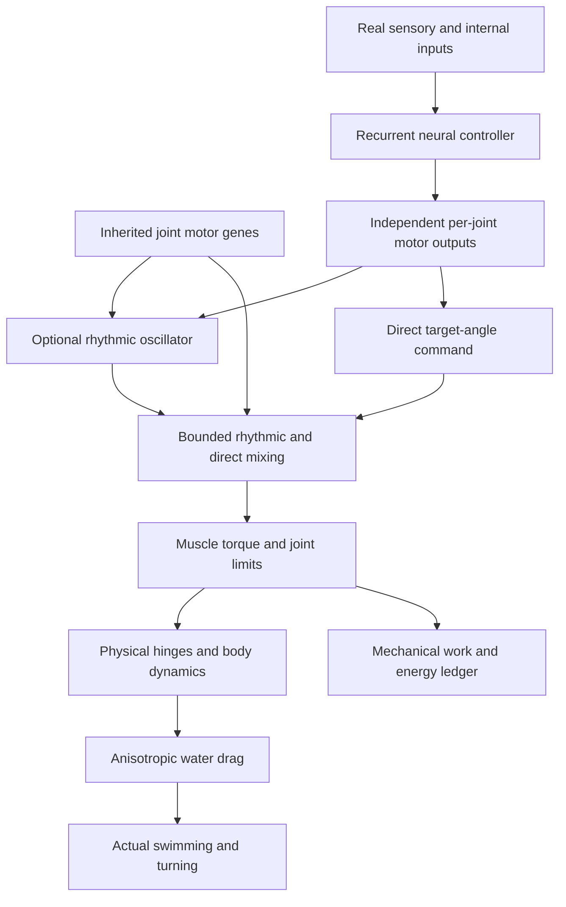
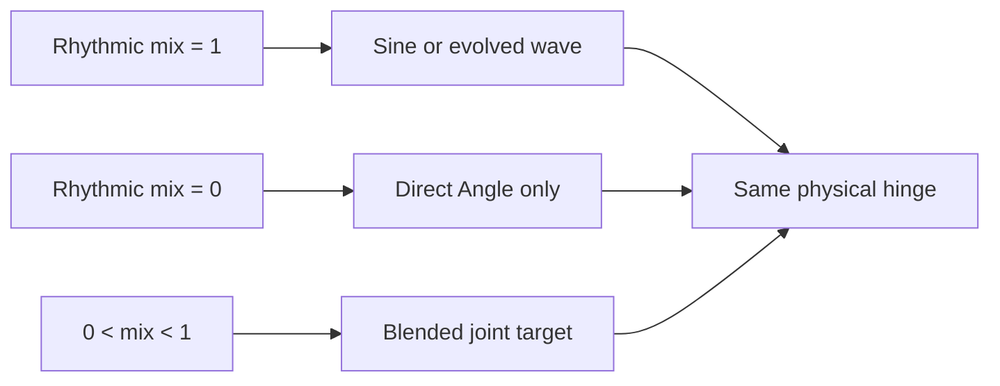

# Movement and Motor Control

VIDA's articulated organisms swim and maneuver using **physical hinges** between rectangular body segments. Muscle torque rotates joints, while anisotropic water drag turns articulated motion into movement. No brain command sets world-space position or applies free forward thrust.

## At a glance

| Property | Current behavior |
| --- | --- |
| Actuators | One torque-driven hinge per connected body part |
| Neural outputs | Six independent outputs per joint: Angle, Drive, Torque, Stiff, Amp, Engage |
| Rhythmic movement | Optional per-joint oscillator with independent phase, speed and amplitude |
| Non-rhythmic movement | Brain-controlled joint-angle posture can operate without an oscillator |
| Waveform | Smooth, bounded combination of sine and up to four inherited harmonics |
| Evolution | Mix and waveform coefficients may mutate separately in offspring |
| Energy | Motor work is deducted from usable energy and becomes heat; no free thrust |
| Old genomes | Missing new parameters take the original sine controller exactly |

## How commands become movement



Each connected joint has its own **oscillatorMix** allele between **0** (fully optional rhythm disabled) and **1** (full rhythmic contribution). Intermediate values blend the rhythmic command with direct neural positioning. The **Angle** output commands posture. The **Amp** output controls the oscillator's actual stroke amplitude: when the oscillator's amplitude reaches zero on an evolved joint, the Angle command obtains the joint's full allowable range. **Engage** can still disengage the muscle, and **Drive**, **Torque** and **Stiff** remain independent joint controls.

These commands do **not** guarantee forward swimming; motion depends on actual morphology, relative phase, torque, water drag, mass and energy availability.

## Waveform design

A joint with no waveform allele executes the original sine wave. Evolved joints can blend the base sine wave with the second through fifth harmonics:

```text
raw(φ) = sin(φ) + a₂ sin(2φ) + a₃ sin(3φ) + a₄ sin(4φ) + a₅ sin(5φ)
wave(φ) = raw(φ) / (1 + |a₂| + |a₃| + |a₄| + |a₅|)
```

- Each `a` coefficient is inherited, mutable, and bounded **−1 to +1**.
- The normalized waveform stays in **[−1, 1]**.
- Harmonic mixtures can approximate asymmetric, triangle-like or sawtooth-like strokes **smoothly**. Discontinuous sawtooth impulses are not generated.
- The creature can independently vary frequency and timing through the existing **Drive** output, and inherits its CPG phase offset and frequency multiplier.
- Individual waveform/phase changes can improve or harm locomotion; successful feeding and steering must be physically measured.

## Inheritance and compatibility

For old organisms and unchanged founder genotypes, both new joint fields are absent. This deliberately runs the original exact sine calculation, preserving existing saved motion and motor energy. Genetic mutation may introduce `oscillatorMix` or `waveHarmonics` on descendants. Offspring inherit those fields, and no parent genome is edited by mutations.

A joint with `oscillatorMix = 0` can use the full range of its direct **Angle** neural command while active. A joint may also set **Amp** to zero and use direct posture, without turning off its muscle. Without a brain command, a direct-only joint does not move on its own.

World snapshots use the existing version-10 schema. New fields are optional, strictly validated on import and round-trip exactly; saved older genomes are never rewritten to acquire new motor alleles.

## Boundaries and current limitations

- This is **joint-space** direct control, not arbitrary forces, fins with lift, suction, jet propulsion or deformable jellyfish bells.
- The oscillator is not a mandatory swimming gait, but evolving coordinated direct control is not guaranteed; poor neural configurations can still fail to move.
- Harmonics share the joint's base phase. Independently evolvable harmonic phase shifts and explicit oscillator reset commands are not implemented.
- The current movement is physically simulated; no claims are made that the newest motor genes have improved ecological fitness across seeds.
- The default founders retain their previously calibrated behavior (including the head-first FND-001 gait).

## Implementation and regression checks

- **Physics/controller:** `simulation.ts` — `evaluateMotorWave`, `calculateJointMotorTarget`, `advanceOrganismPhysics`
- **Inheritance:** `simulation.ts` — `mutateGenome` and `PartDef`
- **Import validation:** `persistence.ts` — `validateGenome`, `restoreSnapshot`
- **Tests:** `tests/evolvable-actuation.test.ts`, `tests/motor-control.test.ts`, `tests/behavior-baseline.test.ts`


