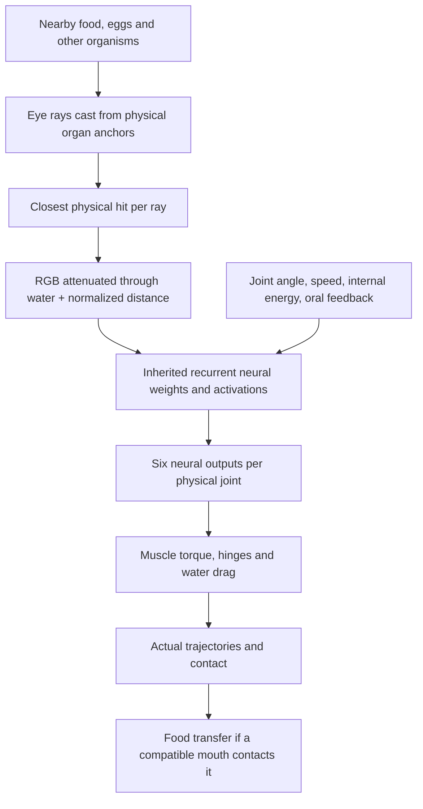

# Senses and Visually Guided Behavior

VIDA organisms sense their environment through real organ geometry and a recurrent, inheritable neural controller. **Seeing an object is not the same as recognizing or reaching it.** Actual locomotion, contact and energy intake depend on the creature's articulated body and physical simulation.

## Sensory pathways

Each eye casts **five rays** across its inherited field of view, from the eye's true body-surface anchor. A ray returns attenuated red, green and blue levels plus a normalized hit distance. The brain also receives joint and movement feedback, energy level, central oscillator phase, and mouth feeding/contact feedback. Sensor and motor pathways are genetically mutable and may use the inherited neural memory timescales.

**Visual rays do not encode object type, identity, diet, hostility, future position or desired steering direction.** The diagnostic display can label hit objects, but those labels do not enter the neural controller. Water and tank walls are black in the eye's perception; presentation glows do not create signals.

## Current inherited visual behavior

- The **balanced** founder mode adds a weak, mutable color-contrast-to-joint prior to the default founder brains. Unbiased mode does not add that prior.
- The **Three-link Darter (FND-001), balanced mode** uses a stronger inherited retinal connection and corrected steering polarity. It was calibrated using physical off-axis nutrient trials; no target-coordinate logic was added.
- The corrected prior responds to **green plant-food contrast** along the rays and translates the response into the existing `Angle` motor output. This steers real joints through ordinary muscle torque and hydrodynamic drag.
- The new connections are ordinary genome weights. They can mutate, be inherited by descendants and interact with their other neural connections. They are *not* online learning.
- Other founders retain their established weak visual priors; old saved organisms retain the neural weights they already possessed.

## Evidence and interpretation

The Darter was compared against the preceding weaker inherited visual weights and against an otherwise matching creature with visual connections disconnected. In **eight** reproducible six-second single-food trials (food on either side of the head, at four distances of 110–190 px), the calibrated sighted genotype made physical contact and ate in **seven** cases; the former weak and retinally disconnected comparison genotypes ate nothing in those scenarios. It also approached closer to the food in all eight trials than its disconnected-vision comparison.

These results establish **short-range, visually influenced nutrient approach for this genotype in the tested geometry**, not generally reliable foraging across all creatures, terrains, pigments or generations. All feeding removes actual finite nutrient energy through a compatible contacting mouth.

## What VIDA cannot yet do reliably

- A creature cannot reliably identify a predator by its danger level from pigmentation alone. Pigment is inherited separately from diet and hostility.
- Visual escape, predator classification and predictive pursuit **have not been demonstrated**.
- Other founder types may swim inefficiently or possess inadequate visual/motor coordination.
- Ecological fitness, lifetime survival and reproductive advantages require controlled longer-term studies.
- No hidden target tracking, automatic pursuit, guaranteed food handouts, scripted escape, synaptic lifetime training or sleeping is added.

## Implementation and regression checks

- `simulation.ts`: organ raycast, RGB attenuation, neural input/output evaluation, true mouth contact
- `founders.ts`: `addRetinalSteeringPrior` (genetic weight initialization)
- `tests/visual-steering-survey.test.ts`: paired visible/legacy/blind physical food approach, conserved energy, old-save behavior and sensory limitations
- `tests/senses-contact.test.ts`: light, geometry and feeding invariants
- `tests/behavior-baseline.test.ts`: locomotion and baseline steering comparisons

This page is a reference to the **current implementation**. It is updated in place; it is not a changelog.
