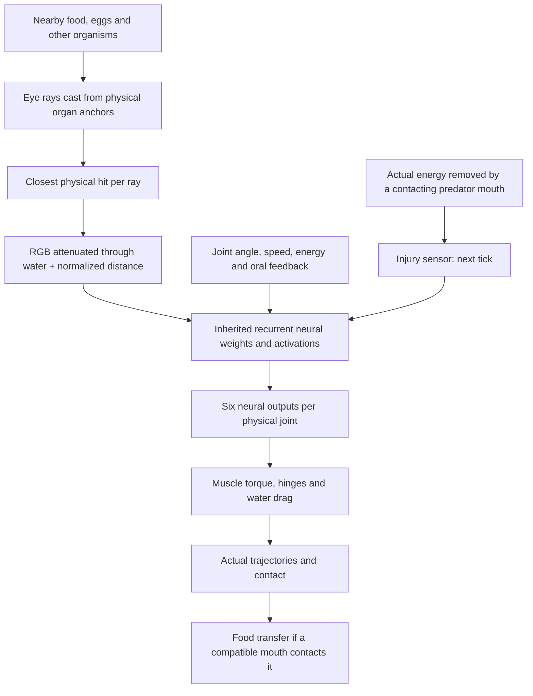

# Senses and Visually Guided Behavior

VIDA organisms sense their environment through real organ geometry and a recurrent, inheritable neural controller. **Seeing an object is not the same as recognizing or reaching it.** Actual locomotion, contact and energy intake depend on the creature's articulated body and physical simulation.

## Sensory pathways

## Somatic injury sensing

A creature now has a **body:injury** neural input that reports actual energy
transferred out of its usable reserves or tissue by a predator's **physically
contacting mouth**. The input is the previous tick's bite loss divided by
60 joules and clamped to **0–1**. Multiple legitimate bites accumulate
within a tick; the stimulus is read once on the following neural update,
then cleared and replenished only by further real bites.

This is *not* a general-purpose enemy radar. Mere proximity, a brightly
colored predator, collisions, ordinary swimming metabolism or low energy
do not trigger it. An animal must first experience a bite to get the cue.

The sensory input enters the same inherited recurrent network as sight,
mouth feedback and joint feedback; its synapses can evolve. **New founder
brains start with this input disconnected**, preserving the previously
calibrated founder behaviors and avoiding a hardcoded universal panic reflex.
Descendants may inherit and mutate connections that use it. Importing older
worlds preserves their weights and neural activations by identity, adding
only a zeroed input.

**Genetic injury-response innovation:** A rare offspring topology mutation,
`wire-injury-motor`, can add an **isolated hidden neuron** connected to this
injury sensor and to one randomly selected existing motor channel across
the body's joints. It chooses independent positive or negative sensory
and motor gains. The new neuron is silent until a real bite occurs, and
its wiring is heritable and subject to later mutation. Nothing
automatically decides which direction is safe or injects thrust; neurons,
connections and muscles consume their usual energy.

**Measured defensive capability:** In seven paired 2.5-second laboratory
scenarios with a stationary predator biting the tail of a Three-link
Darter, a stronger-stroke injury response reduced real stolen energy
from **420–450 J** to **270–330 J**, increasing separation. The reversed,
weaker-stroke response made bites much worse. A separate genetically
generated `Amp` microcircuit reduced stolen energy from **450 J to
330 J** compared with its identical injury-disconnected control.

These results demonstrate a **possible heritable defensive behavior**
under measured stationary-predator conditions. They do not demonstrate
successful escape from a moving or tracking hunter, learned predator
recognition, or long-term ecological advantage.

## Physical eye rays

Each eye casts **five rays** across its inherited field of view, from the eye's true body-surface anchor. A ray returns attenuated red, green and blue levels plus a normalized hit distance. The brain also receives joint and movement feedback, energy level, central oscillator phase, and mouth feeding/contact feedback. Sensor and motor pathways are genetically mutable and may use the inherited neural memory timescales.

**Visual rays do not encode object type, identity, diet, hostility, future position or desired steering direction.** The diagnostic display can label hit objects, but those labels do not enter the neural controller. Water and tank walls are black in the eye's perception; presentation glows do not create signals.

## Current inherited visual behavior

- The **balanced** founder mode adds a weak, mutable color-contrast-to-joint prior to the default founder brains. Unbiased mode does not add that prior.
- The **Three-link Darter (FND-001), balanced mode** uses a stronger inherited retinal connection and corrected steering polarity. It was calibrated using physical off-axis nutrient trials; no target-coordinate logic was added.
- The corrected prior responds to **green plant-food contrast** along the rays and translates the response into the existing `Angle` motor output. This steers real joints through ordinary muscle torque and hydrodynamic drag.
- The new connections are ordinary genome weights. They can mutate, be inherited by descendants and interact with their other neural connections. They are *not* online learning.
- Other founders retain their established weak visual priors; old saved organisms retain the neural weights they already possessed.

## Evidence and interpretation

The Darter was compared against the preceding weaker inherited visual weights and against an otherwise matching creature with visual connections disconnected. In **eight** reproducible six-second single-food trials (food on either side of the head, at four distances of 110–190 px), the calibrated sighted genotype made physical contact and ate in **seven** cases; the former weak and retinally disconnected comparison genotypes ate nothing in those scenarios. It also approached closer to the food in all eight trials than its disconnected-vision comparison.

These results establish **short-range, visually influenced nutrient approach for this genotype in the tested geometry**, not generally reliable foraging across all creatures, terrains, pigments or generations. All feeding removes actual finite nutrient energy through a compatible contacting mouth.

## What VIDA cannot yet do reliably

- A creature cannot reliably identify a predator by its danger level from pigmentation alone. Pigment is inherited separately from diet and hostility.
- A generated genotype can reduce repeated tail bites from a stationary
  hunter, but **robust escape from mobile hunters**, anticipatory predator
  classification and predictive pursuit have not yet been demonstrated.
  The injury input alone has no guaranteed escape effect.
- Other founder types may swim inefficiently or possess inadequate visual/motor coordination.
- Ecological fitness, lifetime survival and reproductive advantages require controlled longer-term studies.
- No hidden target tracking, automatic pursuit, guaranteed food handouts, scripted escape, synaptic lifetime training or sleeping is added.

## Implementation and regression checks

- `simulation.ts`: organ raycast, RGB attenuation, real bite feedback into neural inputs, neural evaluation and true mouth contact
- `founders.ts`: `addRetinalSteeringPrior` (genetic weight initialization)
- `tests/visual-steering-survey.test.ts`: paired visible/legacy/blind physical food approach, conserved energy, old-save behavior and sensory limitations
- `tests/injury-sense.test.ts`: real-bite-only injury cue, conservation, migration, invalid saves
- `tests/bite-escape-survey.test.ts`: real transferred bite joules, beneficial/harmful inherited actuation, randomly generated isolated injury-motor circuits, and exact-save continuation
- `tests/senses-contact.test.ts`: light, geometry and feeding invariants
- `tests/behavior-baseline.test.ts`: locomotion and baseline steering comparisons

This page is a reference to the **current implementation**. It is updated in place; it is not a changelog.
