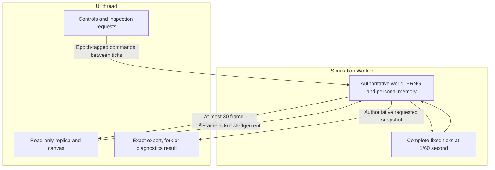

# Simulation Performance

The authoritative **1/60-second simulation runs in a Web Worker**. Rendering
and controls remain on the UI thread. Every creature continues sensing,
moving and evolving off-camera. Worker separation is integrated and deployed.

## State ownership and rendering

World commands run between complete fixed ticks. Exports, forks and diagnostics
use authoritative Worker state, including randomness and acquired memory;
render replicas are not saves. Epochs reject stale-world messages.

Render transport is bounded to 30 updates/s with one frame in flight. Genomes
travel once; lineage sends actual changed records after an initial transfer.
Heavy neural arrays travel only for a selected creature with diagnostics open.
Canvas painting can run independently of those updates. Paused worlds do not
stream unchanged frames; Worker errors pause visibly.

Batches yield after about 8 ms. Overdue work resumes through MessageChannel;
light worlds pace themselves and paused worlds idle. Unsupported Workers use
a main-thread fallback; `?mainthread` explicitly selects it for diagnosis.

## Worker and display architecture



Painting does not advance simulation time. The main-thread fallback retains
fixed-tick behavior when the Worker is unavailable or explicitly disabled.

## Stable toolbar layout

The toolbar uses right-anchored desktop controls, with Menu kept
at the top-right. General telemetry uses the horizontal space left by controls.
Generation, achieved speed/FPS/steps and elapsed time move together as one group;
only a container narrower than the group requires its compact internal layout.

Author credits are optional when space is scarce. Measured item widths keep them
visible whenever they do not add a row. They can hide to retain a single general
row, and fit alongside the identity again when the metrics already need their
own row. The decision uses reserved geometry, never changing statistic values.

Six monospace characters are reserved per count/generation and twelve for elapsed
seconds. The performance chip reserves the whole readout while its text remains
naturally packed, without individual numeric padding. Oversized numbers use
scientific notation with their full values in hover titles. These are display
rules only; simulation values, controls, Worker behavior and saves are unchanged.

Phones use five evenly spaced icon action buttons and one full-width speed row,
with Menu pinned beside the identity. Counters show distinguishable icons and
reserved values in two rows; names and the food target remain in accessible
labels/tooltips. Desktop counters retain their text labels and food target.
Changing statistics does not reflow the toolbar or alter tank bounds at a fixed
viewport.


## Stopped time and manual interaction

**0x is the paused simulation speed**. Pause and Space toggle
between 0x and the last selected nonzero speed. Selecting another speed resumes
immediately. Finite speeds remain 1x, 2x, 5x, 10x and 20x; MAX runs without a multiplier ceiling.
Imports start at 0x. The speed selector shows the effective speed, including 0x
while the application menu is open; closing that menu restores the prior state.

At 0x, simulation time and all autonomous processes stop. The tank stays
interactive: select and inspect creatures/eggs, open diagnostics and other
panels, pan/zoom, add creatures/food, clear free nutrients, edit applicable
settings and import/export exact worlds. The pause screen no longer covers
these controls. Start, application-menu and extinction overlays retain their
own behavior.

Manual actions still use the authoritative Worker commands and existing
validation, energy funding and population/food limits. Accepted edits refresh
the rendered world without a simulation tick; added food is not eaten until
time resumes. Stopped wall time and unfinished pacing debt are discarded when
the speed changes. The main-thread fallback follows the same pause controls.
Save schemas, physics, genetics, feeding and learning rules are unchanged.


## Live performance circle

The existing 12px header circle shows actual simulation throughput. Pulse frequency
is `2.5 * log(1 + min(actualSpeed, 50)) / log(51)` Hz: about 0.44 at 1x,
1.52 at 10x and 2.5 at 50x and above. Only the visual frequency saturates.

Each pulse expands outward from its normal radius to 2.5 times that radius while
fading from full opacity to transparent, then repeats. Its visual diameter grows
from 12px to 30px; its layout box stays 12px square, so neighboring elements do not
move. The existing animation changes only transform and opacity, without adding
per-frame JavaScript, particles, blur or shadow effects.

Finite speed colors show actual/requested achievement, capped at 100%:
red at 10% or less, orange at 30%, yellow at 60% and green at 100% or more.
MAX uses 50x as a **visual reference**, with the same anchors through green,
then pure cyan at 65x and pure white at 75x and above. Colors interpolate
continuously in Oklab. White never resets at higher throughput.

MAX is an explicit unlimited mode, replacing the old paced 50x alias after
contributor approval. Worker batches yield after 8ms or 256 ticks and immediately
queue the next batch; fallback execution shares the UI thread with a 16ms batch
budget. These are responsiveness budgets, not simulated-speed multipliers.
Fixed 1/60-second ticks, finite-speed pacing, physics, ecology and saves are unchanged.
A world can age much faster in wall time in MAX; this does not change its rules.

The circle and existing speed readout share a constant-size sampler of authoritative
simulation time divided by monotonic wall time. It uses 250ms windows and 350ms
exponential smoothing. Mode/world changes establish a fresh baseline; missing
measurements expire after 1.25s. No speed is inferred from selected multipliers,
render FPS or CPU utilization. World-stat rendering is bounded to four updates/s.

At 0x, the retained animation holds its exact current phase, opacity and scale.
Any in-progress color transition is frozen at the displayed color. Manual world
commands do not advance the pulse. Resume waits for fresh measurements and adjusts
playback rate without resetting the animation timeline. Reduced-motion preferences
hold the movement while keeping performance color available.

There is **no tooltip, hover content, popover, visible explanatory text or new
interaction**. Nonvisual screen-reader descriptions distinguish paused, measuring,
unavailable, finite achievement and MAX's visual reference. During startup or a
mode change, the pulse waits for fresh data; stale running data becomes neutral.


## Optional caustic rendering — contributor fork

**Fork-only; pending upstream acceptance.** Advanced Settings includes
**Show water caustics**, which controls the blurred decorative water-light
patterns. It starts enabled in Default World and disabled in Harsh World and
Pipe World. Disabling it skips the caustic canvas fill/blur calls without
removing caustic state, changing Worker settings or modifying sensory inputs.
The user can enable it again at any time; the choice is retained in observer
snapshot metadata. Historical snapshots without the option render caustics.

The option changes presentation only. Its impact on displayed FPS depends
on the browser and graphics backend; it is not a measured or guaranteed
change to simulation ticks/s.

## Current optimizations

| Area | Strategy |
| --- | --- |
| Neural evaluation | Transient topology/masks and ordered enabled-row loops; live weights remain authoritative |
| Personal learning | Reused records/buffers; aligned records overwrite eligible slots directly |
| Vision | Conservative physical-bounds ray queries in original candidate order |
| Feeding | Separate post-movement aperture indexes, invalidated when food/eggs change |
| Contacts | Reused cell buckets, pair ownership, current-pass rotations and fixed clipping buffers |
| Hinges/hatching | Reuse invariant geometry within its valid solve/pass; refresh moving bounds and add newborn bounds immediately |
| Lineage | Subscribe to births, laying and deaths instead of rescanning unchanged ancestors |
| Painting | Cached food/remains glows and viewport culling of paint calls |

These optimizations preserve physical substeps, sensing rates and numerical
ordering. Spatial/neural scratch is transient and never saved. New corpses
produce one conserved-energy circle; closed worlds aggregate carrion at the
food safety limit instead of discarding it. Stored fragments remain intact on import. See [Ecology](Ecology-Baseline).

## FPS and simulation speed

**FPS** measures presentation. **Steps/s** measures physical ticks completed.
Real-time 1x requires 60 ticks/s; 5x requires 300. A responsive display can coexist
with a CPU-limited simulation that falls short of its requested multiplier.

There is no universal browser-speed guarantee. The original roughly
100-creature/1,000-part ambition is unverified, and current anatomy is capped
at seven parts. Joints, ray geometry, evolved brains and population size can
still dominate cost. Native packaging alone does not remove those costs;
compiled/WASM kernels are a separate future option.

## Checks and diagnostics

```sh
npm run test:fast
npm run build
npm run test:worker
```

The Worker check executes the production bundle on a real thread. Focused
Chromium/Firefox checks cover actual UI/Worker integration in CI.

- `npm run benchmark:performance -- --baseline /path/to/checkout`: same-state kernel comparison.
- `node --import tsx scripts/profile-performance.mjs [checkout] [output.json]`: four bounded CPU profiles, including a synthetic Gen-6 tank. Original catalogue genes/phases pin the historical state hashes.
- `node --import tsx scripts/benchmark-runtime-components.mjs <baseline-checkout>`: isolated collision, learning-buffer and lineage costs.

Synthetic and component measurements do not predict a user's browser FPS.
Historical timing tables are in
[project status](https://github.com/smeagol44/vidAI/blob/main/docs/PROJECT_STATUS.md).

## Economy state and capacity

Current exports use schema v16 without tube topology and v17 with self-linked
tubes. Both retain the saved physics, economy and prey-contact model, forward
mouth genomes and immutable egg reserve references. Schema v17 validates its
physical topology; older formats reject topology fields. Historical formats,
including v12–v15, remain importable through the accepted automatic mouth
conversion described in [Ecology](Ecology-Baseline#physical-mouth-aperture).
That migration changes future mouth geometry; it is not a promise of identical
historical feeding. Other saved state and PRNG data are retained.

Closed saves persist live reserve/budget and egg age/target. Explicit solver
stabilization changes only physics on an authoritative snapshot; explicit mouth
contact upgrade changes only the contact model. Budget edits are Worker actions
between ticks. Imports and explicit conversion use authoritative state; control
packets cannot switch physics or ecology regimes.

Population remains bounded at 30 slots initially (living creatures plus eggs in
closed worlds), adjustable to 150. The separate 75-egg computational limit is
retained. Food conversion stops at 2,200 particles and banks remaining energy;
one extra carrion slot plus carrion aggregation preserves remains at capacity.
Unlimited ecological nutrients does not remove these computational safeguards.

## Transient interface messages

Notifications expire after 2.5 seconds of wall time, including while paused.
Replacing a message or repeating the same message restarts its lifetime; an old
message cannot dismiss its replacement. Noninteractive banners do not capture
pointer input. Hinge dots are hidden; physical joints and their Worker data remain.
This removes drawing commands, with no measured FPS or solver-speed claim.

## Central grid primitive — contributor testing only

P1 adds `centralSpatialGrid.ts`, a typed, incrementally maintained matrix with
fixed maximum-aquarium capacity, registration/relocation/removal, and unique
conservative cell/bounds/ray candidates. P4 now maintains its membership in the
authoritative simulation alongside the existing broadphases; their physical and
sensory results remain unchanged. P5 adds optional integrity inspection; P6 adds optional observer overlays from its actual memberships. P4 retains explicit source-array/part ranks for later query
migration. No speedup is claimed.
See the [P1 API, bounds and memory contract](https://github.com/hernansgarro/vidAI/blob/testing/docs/contributor-workspace/performance/CENTRAL_GRID_P1.md).
This section describes the fork's testing work, not upstream shipped behavior;
the actual Wiki is not published as part of this task.

## Conservative creature envelope — contributor testing only

P2 adds `creatureEnvelope.ts`, an anatomy-time mass-weighted tree-path bound
covering body rectangles under all rotations, branches and COM shifts. A finite
multi-part lifetime guarantee requires a proven maximum hinge-anchor gap, which
the current solver/import validation does not supply. Without that certificate,
the API explicitly reports an unbounded lifetime envelope and offers a safe
current-pose square using cached anatomy geometry; it never assumes a small
solver residual. P4 now uses the current-pose fallback for authoritative shadow
membership, preserving rendering and existing consumer queries. No physics,
optics, feeding, save or UI rule changes, or performance improvements, are claimed.
See the [P2 contract and proof](https://github.com/hernansgarro/vidAI/blob/testing/docs/contributor-workspace/performance/CREATURE_ENVELOPE_P2.md).
This describes fork testing source only; actual upstream Wiki publication and
later query migration remain separate.


## Diagnostic console — contributor testing only

**Fork testing only; not accepted or shipped upstream.** Open Settings → Advanced
Settings → System diagnostics to read real Worker lifecycle/error and snapshot
import events, plus optional P5 grid-integrity reports. Each row has a local wall-clock timestamp, severity, subsystem
and description. Newest entries appear first. Severity and subsystem filters
combine; Clear history removes all events. Back or Escape returns to the
advanced options. Keyboard actions in the console do not trigger playback or
feeding shortcuts; the window fits the tank viewport on phones.

History retains the latest 200 entries with bounded message/subsystem text,
including while closed. Reload clears it; world imports do not. It is session
observer data, not snapshot metadata, local storage or a creature sense. The
central reusable store accepts scalar severity/subsystem/message events and
isolates failed observers. Only the visible console subscribes to updates;
there is no console polling or event generation per tick. P5 forwards bounded
scalar audit messages through the existing acknowledged Worker frames.
Existing Worker errors still pause visibly through their original handler.

The P3 store remains independent of P1/P2; P5 supplies its grid-integrity
producer. The console does not repair errors, draw grid overlays or change
simulation state/PRNG/physics. Its ordinary observer
cost is not a throughput claim. Source API details and limitations:
[P3 contract](https://github.com/hernansgarro/vidAI/blob/testing/docs/contributor-workspace/performance/DIAGNOSTICS_CONSOLE_P3.md).


## Maintained spatial membership — contributor testing only

**Fork testing only; not accepted or shipped upstream.** The authoritative world
maintains a central 128-unit matrix alongside the existing spatial indexes.
Individual body parts, whole-organism prey views, nutrients/carrion and eggs
retain transient local membership handles. All completed physics/contact/joint
pose updates, particle/tube motion, lifecycle changes and paused commands update
the affected views. Unchanged cell ranges do not rewrite buckets. Import/reset
reconstructs membership and removes previous-world records; handles never travel
in frames or saves. Source-array/part ranks retain existing interaction ordering.

Articulated bodies have no guaranteed finite lifetime radius under the current
solver/import rules. Their conservative current-pose square is refreshed after
movement. Entries outside fixed capacity or exceeding bounded membership storage
remain explicit always-candidates, including arithmetic overflow; nothing is
silently clipped or culled. Existing vision, feeding and contact queries still
run unchanged. P5 now provides optional independent audits, without repair. P6 adds observer overlays; no
extra creature sense or measured speedup is introduced. See the [P4 contract](https://github.com/hernansgarro/vidAI/blob/testing/docs/contributor-workspace/performance/MAINTAINED_GRID_P4.md).


## Independent grid audit — contributor testing only

**Fork testing only; not accepted or shipped upstream.** In Advanced Settings,
**Audit grid now** inspects the authoritative world (also while paused), then
opens System diagnostics. **Periodic grid integrity audit (60 simulated seconds)**
is OFF by default. Enabling starts a fresh60s simulated interval. Pauses stop
that clock; speed changes only its wall duration. Imports/restarts keep the
session toggle and reset the deadline from restored time. Manual audits do not
postpone it. Reload starts disabled; the option is never saved in snapshots.

A fresh authoritative identity/geometry reference is compared to raw cells,
roster/local handles, categories, ranks and counters without query deduplication
or synchronization. Missing, extra, duplicate, misclassified, stale and wrong-cell
entries produce bounded severity/subsystem/timestamp reports, with simulated
time and useful identity/cell context. Legitimate P4 out-of-capacity, arithmetic
and budget overflow entries remain unconditional candidates and pass validation.
No audit repairs the grid or changes physical state, PRNG or existing queries.

Clean runs emit one info summary; errors retain at most20 investigation details
with total findings, and an explicit truncation warning. Pending Worker transport
is capped at64 events plus a dropped-count summary; P3 retains200 session rows.
Disabled mode does no reference/cell work. Enabled audits incur diagnostic CPU
and allocation cost; no performance gain is claimed. See the [P5 contract](https://github.com/hernansgarro/vidAI/blob/testing/docs/contributor-workspace/performance/GRID_INTEGRITY_P5.md).


## Spatial diagnostics overlays — contributor testing only

**Fork testing only; not accepted or shipped upstream.** In **Ecology & Physical
Settings → Advanced Settings**, enable **Show spatial cell borders** and/or
**Show creature enclosures**. Both start OFF on reload, are independent and stay
selected across session imports/restarts. They never enter saved settings.

Cells show actual maintained assignments: nutrients green, carrion/eggs red,
creatures blue, combining saturated RGB channels. Repeated occupants do not
brighten a channel. Empty cells have no outline. Subtle one-CSS-pixel inward
outlines follow camera/zoom/DPR and the existing tank/tube fade, after decoration
and below creatures. Overflow has no matrix cells and is explicitly counted.

Enclosures show P4's actual conservative squares. Dashed blue is current-pose
fallback; solid blue is a finite anatomy certificate. The articulated ideal
anatomy radius is not an unconditional lifetime guarantee. Finite overflow
squares remain drawable; unbounded ones are counted. No forward mouth, glow or
sight range is included. Disabled overlays skip collection and payloads; enabled
data travels only in acknowledged render frames, outside physical snapshots and
senses/brains/energy. Existing feeding/vision/contact broadphases are unchanged.
See the [P6 contract](https://github.com/hernansgarro/vidAI/blob/testing/docs/contributor-workspace/performance/SPATIAL_OVERLAYS_P6.md).
