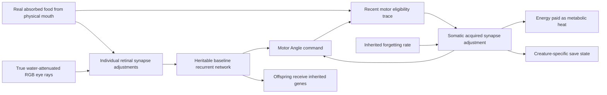

# Waking Synaptic Learning

VIDA creatures can now **acquire motor and retinal synapse adjustments
while alive**, if those optional capabilities evolve. Learned changes
are individual experience, not inherited weights; genuine food intake
reinforces active circuits, and real bites may punish them. The changes
consume energy and fade at genetically determined rates.

The **original Phase 5 waking-learning feature set is now
implemented as a bounded prototype**: inherited learning
capacity, personal retinal/motor adaptation, physical feedback,
energy-paid upkeep, forgetting, and selective consolidation.
Learned experience has now changed real subsequent feeding in
both helpful and harmful directions. **Robust learned food seeking,
long-term ecological fitness, and reliable generalization remain
unproven.**

## Mechanism

### Inherited capability, acquired experience

- **`plasticityRate`** is an optional inherited allele (0–0.8 per
  second); absent or zero means **no learning** and the exact old
  runtime network. A rare ordinary asexual mutation may introduce
  or alter it. **`forgettingRate`** is an optional inherited
  relaxation allele (0–1 per second; default 0.1 when enabled).
- A learning-capable organism maintains up to **96 enabled
  hidden-neuron → motor synapses**. Older and default creatures retain
  the original Angle-only candidate selection, in the same order.
  Descendants may genetically evolve `plasticMotorScope: 'all'`
  to distribute learning across **Angle, Drive, Torque, Stiff, Amp
  and Engage** on *all joints*, interleaving outputs to avoid
  exhausting the bound on the first joint. The disabled-connection
  mask and stable identities remain authoritative. No new force
  or behavioral action is scripted.
- An **eligibility trace** (memory of actual recent hidden activation
  × motor output, with a 0.6-second time constant) associates recent
  command activity with the **previous completed tick's genuine
  compatible-mouth absorbed intake**. Actual absorption—not visual
  proximity, food color, or a diagnostic label—is the reward.
- After a neural update, the individual can change its own bounded
  synapse offset by a reward-modulated amount. Offsets are limited to
  **±0.8 per edge**. Learned synapses modify subsequent neural
  motor commands and therefore use the same pre-existing
  torque-limited hinges and water resistance. Unrewarded offsets
  relax exponentially; no learning or decay step changes inherited
  genomic weights.
- **Energy:** maintaining eligible plastic edges costs
  **0.002 J per active synapse per second**, and rewriting costs
  **0.4 J per unit absolute weight adjustment**. Both are actually
  removed from creature reserves, placed in the metabolic heat ledger
  and limited by available energy. Plasticity is not free and
  cannot keep changing synapses after reserves are exhausted.

### Lifetime memory versus inheritance and previous brain memory

Inherited recurrent weights remain in `genome.weightsIH` and
`genome.weightsHO`. Per-creature `learnedSensoryWeights`
(eye → hidden) and `learnedMotorWeights` (hidden → motor) contain
individual acquired `delta` and recent `eligibility` under
stable synapse keys.
**Newborns inherit the ability to learn and the genetic baseline,
never the parent's learned offsets or eligibility.** Their learned
state begins empty. Old saves continue unchanged. Current schema
**v11** saves/reloads the new optional somatic state exactly, with
strict bounds, stable identities and no resetting of ongoing learning.

This differs from the earlier **activation-memory timescale**:
leaky recurrent activations remember recent neural *activity*; Phase
5 plasticity changes an effective synaptic connection *while alive*.
Neither feature is simulated dreaming or replay.

The selected creature's Brain diagram uses the **effective weight**
(inherited weight plus acquired offset) for both retinal and motor
connections.
When learning is enabled it also displays genetic learning/forgetting
rates, motor scope, injury-aversion rate, count of adapted motor
and retinal synapses, and metabolic plasticity cost.
It does not show an invented food target or prescribe behavior.

## Learning from similar sensory context

A separately heritable, mutable **`sensoryPlasticityRate`**
(0–0.8 per second) allows a creature to change up to **96 enabled
existing eye RGB → hidden neuron synapses** during life. Actual
water-attenuated physical rays are the only visible input: no food
category, enemy identity, target coordinates, object-type diagnostic
or steering direction is provided.

A 0.6-second eligibility trace combines recent RGB activity with
hidden-neuron activation. Physically absorbed food gives positive
reinforcement and, if aversion evolved, real bite damage gives
negative reinforcement. A colored object alone cannot reward an
animal. Acquired weights apply on the next neural evaluation, when
similar retinal input can change hidden and downstream motor
activations. Old founders lacking the gene are unaffected.

Offsets are bounded to ±0.8, forget according to the organism's
inherited rate, and cost **0.002 J per eligible synapse per second**
plus **0.4 J per unit changed weight**. All costs are debited from
the organism into metabolic heat. The acquired retina and trace
belong only to the individual, persist through current schema-v11
save/load, and never enter offspring DNA.

**Short causal evidence:** A creature absorbed **1,440 J of real
finite nutrient energy** from physical mouth contact, developing
RGB-to-hidden associations. A matched clone whose learned retinal
deltas were erased then produced a different hidden response
(maximum difference approximately **0.255**) and different neural
motor output when exposed to the same subsequent stimulus.
A food-free control did not learn. This establishes personal
perceptual adaptation—not discrimination between food and predators,
generalization to unseen objects, better navigation or survival.

## Selectively consolidated lifetime memories

A rare, inherited **`memoryConsolidationRate`** allele (0–2/s)
allows living individuals to preserve **some** of their acquired
motor and retinal synaptic adjustments longer than others.
The organism must already possess motor or retinal plasticity;
an animal without learning has nothing to consolidate.

- Eligibility and reward still come exclusively from the existing
  recurrent neural activations and **actual food absorption** or
  **physical bite damage**. A learned connection gains consolidation
  only when a later signed teaching signal agrees with its previous
  acquired weight change. Mere vision, contact without eating,
  or memory replay is not reinforcement.
- Conflicting reinforcement reduces the stored consolidation more
  quickly. Unreinforced consolidation declines gradually. Between
  experiences, stronger consolidation reduces the inherited
  forgetting rate by up to **95%**; it never makes forgetting
  impossible. The same existing ±0.8 weight-delta bounds apply.
- Every living individual maintains a bounded 0–1
  `consolidation` fraction on its *own* eligible learned retinal
  and motor synapses. There are still at most **96 eligible
  retinal and 96 eligible motor synapses**; no extra neuronal
  layer, food-class labels, targeted navigation or new body
  movements are introduced. Acquired weights and consolidation
  are saved exactly in schema v11 and **never copied to children**.
- Consolidation costs additional real energy:
  **0.004 J per fully consolidated eligible synapse per second**
  on top of the existing plastic synapse upkeep and rewriting
  costs; partially stabilized synapses pay proportionally.
  The current energy ledger accounts for this as metabolic heat.
  When energy is insufficient, increases in stored
  consolidation are limited rather than given away freely.
- Old founders, old/current worlds without the new allele,
  and original waking learners lacking consolidation retain
  **their exact previous forgetting behavior**. The Brain
  inspector now shows inherited consolidation rate and count
  of stabilized retinal and motor connections.

**Measured bounded result:** Following genuinely absorbed finite
food, an earned-consolidation animal and a matched clone with the
same already-learned weights but **no consolidation** were given
four seconds with no new food. Their total remaining learned
weight magnitudes were **0.5673 versus 0.3869**, roughly **47%
more retention** in the protected creature. The strengthened
connections still decayed, remained creature-specific and paid
normal energy costs. This measures selective *synaptic
retention*, not that a retained association reliably increases
physical feeding, navigation or survival.

## Learning from genuine injury

An additional **`injuryAversionRate`** allele (0–1 per second,
optional and independently heritable/mutable) lets an animal use
physically inflicted injury as **negative reinforcement**. The
neural teaching signal is the same `body:injury` channel that
reports actual usable/tissue energy removed by a compatible
predator mouth. It cannot be triggered by a nearby predator,
a colored body, a harmless collision or ordinary energy use.
The net teaching signal is the inherited learning rate times
real mouth absorption **minus** the inherited aversion rate times
real injury. The change still acts only through the creature's
existing neurons and torque-limited physical motor controls.
Nothing decides which way to escape or whether a particular
movement is useful.

The new `all` scope and optional aversion are explicitly
mutated at asexual reproduction. An offspring inherits those
*learning capabilities* but never the parent's acquired weights
or eligibility traces. The same 96-edge limit, per-edge energy
upkeep, rewriting cost, forgetting and strict save validation
apply. Older genomes lacking these genes retain the exact old
learning scope and zero pain aversion.

## Physically useful—and harmful—learning

A short native-physics experiment starts with an articulated,
freely swimming Darter carrying optional evolvable plasticity
traits. It travels through a finite patch of ordinary, static
nutrients and physically feeds, thereby changing its own
retinal and motor synapses. The resulting world is cloned:
the baseline genome, muscles, other physics, initial position,
energy, neural activation and PRNG are the same. In the
counterfactual, **only personal learned weight deltas, eligibility
and consolidation are erased**; the genetic capacity to learn
remains intact.

The two versions then encounter one new finite nutrient
at the same off-axis or centered position. Their **actual
gross nutrient removals** during the next five seconds were:

| Second-food condition | Experience retained | Experience erased | Effect |
| --- | ---: | ---: | ---: |
| Forward, 120 px | 3,000 J | 3,000 J | Tie |
| Forward 130 px, -34 px lateral | 3,000 J | 2,820 J | **+180 J** from learning |
| Forward 130 px, +34 px lateral | 2,580 J | 3,000 J | **-420 J** from learning |
| Forward, 130 px | 3,000 J | 3,000 J | Tie |

All comparisons conserve physical energy. These are **controlled
possibilities**, not statistically independent genotype wins:
the same genetically defined Darter is reused and the two centered
comparisons largely agree. A single useful side is evidence that
learning *can* improve actual physical feeding, while the
worse side demonstrates why this does **not** imply
reliable generalization or overall survival improvement.

The bounded integration check includes a short world with
100 learning-capable, physically articulated organisms and
verifies finite reserves, capped synapses and conservation.
It is **not a guaranteed simulation FPS, long-duration
population benchmark, or the target 100 creatures ×
10 parts performance certification**.

### What remains outside the original Phase 5 implementation

The core mechanisms of waking within-life learning are
implemented. Still open as actual biological results:
consistent food-finding improvement across many contexts,
adaptively avoiding predators, generations of self-sustaining
evolution, measurable fitness gains and appropriate
performance at long-lived 1000-part ecosystems.
These are not prerequisites for claiming that individual
synaptic learning exists, nor are they secretly solved.

**Original Phase 6 rest/sleep and experience replay is
optional, separate, and not yet implemented.**

## Verified and not yet verified

- In a narrow physical-contact operant test, a one-neuron policy
  exposed to **2,400 J absorbed from real finite plant food** grew
  an existing `Angle` motor output from approximately **0.642**
  to **0.691**, while a genetically matching unfed control remained
  at **0.642**. The trained genome's original genetic weight did
  not change. The altered command existed only in the exposed animal,
  and fading lowered its acquired offsets in subsequent food-free
  steps.
- That test deliberately sets **motor force to zero** to isolate
  synaptic learning and energy accounting from changes in swimming
  geometry. It proves a within-life **reward-conditioned neural
  response**, **not** improved physical searching, eating, survival,
  reproduction, or general foraging.
- Short tests additionally exercise active joint mechanics and
  learned non-Angle commands during real finite food contact;
  another uses a real biting predator versus harmless contact
  to verify pain-based negative reinforcement. These are working
  mechanisms, **not** proof of improved foraging or escape.
- Tests also require real feeding receipts, finite energy accounting,
  correct newborn inheritance, mutation reachability, exact saved
  continuation and rejection of maliciously invalid plastic
  synapse IDs/weights. All 55 existing founders have the allele
  absent and retain their former behavior exactly.

**Original Phase 5 is complete as a bounded feature implementation,
not as general ecological learning competence.** No sleeping, replay,
experience handouts, extra thrust, hardcoded target selection or
within-life topology growth exists today.

## Code and checks

- `simulation.ts`: `plasticMotorEdges`, `plasticSensoryEdges`,
  `applyWakingPlasticity`, `applySensoryAssociations`,
  physical feedback and recurrent evaluation
- `persistence.ts`: save validation and diagnostic report
- `BrainGraph.tsx`: effective live weights and read-only acquired
  learning statistics
- `tests/waking-plasticity.test.ts`: controls, real reward,
  forgetting, mutation, inheritance, conservation and save integrity
- `tests/sensory-association.test.ts`: real food-conditioned RGB
  plasticity, matched erased-memory replay, conserved energy,
  strict saves and genetic/non-genetic separation
- `tests/selective-memory.test.ts`: earned stabilization of retinal
  and motor associations; real feeding and matched four-second
  no-food forgetting, exact save continuation, conservation,
  inheritance and malicious-save rejection
- `tests/learned-physical-outcome.test.ts`: actual swimming,
  earned food exposure and cloned second-food outcomes,
  conserved usable energy and bounded population sanity

The Wiki describes current features; experimental history belongs
in `docs/PROJECT_STATUS.md`.
