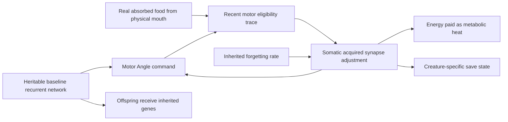

# Waking Synaptic Learning

VIDA creatures can now **acquire motor-synapse adjustments during their
own lifetimes**, provided they inherit a nonzero plasticity allele. These
changes are separate from the inherited genome, adapt only existing
enabled synapses, use physical mouth intake as reinforcement, cost usable
energy, and gradually fade when not reinforced.

Original Phase 5 now includes a second functional increment:
evolvable full-body motor learning and real-bite aversion. These are
real within-life changes to motor policy, **not yet proven to improve
lifetime food-gathering or survival outcomes**.

## Mechanism

### Inherited capability, acquired experience

- **`plasticityRate`** is an optional inherited allele (0–0.8 per
  second); absent or zero means **no learning** and the exact old
  runtime network. A rare ordinary asexual mutation may introduce
  or alter it. **`forgettingRate`** is an optional inherited
  relaxation allele (0–1 per second; default 0.1 when enabled).
- A learning-capable organism maintains up to **96 enabled
  hidden-neuron → motor synapses**. Older and default creatures retain
  the original Angle-only candidate selection, in the same order.
  Descendants may genetically evolve `plasticMotorScope: 'all'`
  to distribute learning across **Angle, Drive, Torque, Stiff, Amp
  and Engage** on *all joints*, interleaving outputs to avoid
  exhausting the bound on the first joint. The disabled-connection
  mask and stable identities remain authoritative. No new force
  or behavioral action is scripted.
- An **eligibility trace** (memory of actual recent hidden activation
  × motor output, with a 0.6-second time constant) associates recent
  command activity with the **previous completed tick's genuine
  compatible-mouth absorbed intake**. Actual absorption—not visual
  proximity, food color, or a diagnostic label—is the reward.
- After a neural update, the individual can change its own bounded
  synapse offset by a reward-modulated amount. Offsets are limited to
  **±0.8 per edge**. Learned synapses modify subsequent neural
  motor commands and therefore use the same pre-existing
  torque-limited hinges and water resistance. Unrewarded offsets
  relax exponentially; no learning or decay step changes inherited
  genomic weights.
- **Energy:** maintaining eligible plastic edges costs
  **0.002 J per active synapse per second**, and rewriting costs
  **0.4 J per unit absolute weight adjustment**. Both are actually
  removed from creature reserves, placed in the metabolic heat ledger
  and limited by available energy. Plasticity is not free and
  cannot keep changing synapses after reserves are exhausted.

### Lifetime memory versus inheritance and previous brain memory

The inherited recurrent neural weights remain in `genome.weightsHO`.
The per-creature `learnedMotorWeights` entries contain the acquired
`delta` and recent `eligibility`, identified by stable synapse key.
**Newborns inherit the ability to learn and the genetic baseline,
never the parent's learned offsets or eligibility.** Their learned
state begins empty. Old saves continue unchanged. Current schema
**v11** saves/reloads the new optional somatic state exactly, with
strict bounds, stable identities and no resetting of ongoing learning.

This differs from the earlier **activation-memory timescale**:
leaky recurrent activations remember recent neural *activity*; Phase
5 plasticity changes an effective synaptic connection *while alive*.
Neither feature is simulated dreaming or replay.

The selected creature's Brain diagram uses the **effective weight**
(inherited weight plus acquired offset) for each motor connection.
When learning is enabled it also displays genetic learning/forgetting
rates, motor scope, injury-aversion rate, count of adapted motor
synapses and metabolic plasticity cost.
It does not show an invented food target or prescribe behavior.

## Learning from genuine injury

An additional **`injuryAversionRate`** allele (0–1 per second,
optional and independently heritable/mutable) lets an animal use
physically inflicted injury as **negative reinforcement**. The
neural teaching signal is the same `body:injury` channel that
reports actual usable/tissue energy removed by a compatible
predator mouth. It cannot be triggered by a nearby predator,
a colored body, a harmless collision or ordinary energy use.
The net teaching signal is the inherited learning rate times
real mouth absorption **minus** the inherited aversion rate times
real injury. The change still acts only through the creature's
existing neurons and torque-limited physical motor controls.
Nothing decides which way to escape or whether a particular
movement is useful.

The new `all` scope and optional aversion are explicitly
mutated at asexual reproduction. An offspring inherits those
*learning capabilities* but never the parent's acquired weights
or eligibility traces. The same 96-edge limit, per-edge energy
upkeep, rewriting cost, forgetting and strict save validation
apply. Older genomes lacking these genes retain the exact old
learning scope and zero pain aversion.

## Verified and not yet verified

- In a narrow physical-contact operant test, a one-neuron policy
  exposed to **2,400 J absorbed from real finite plant food** grew
  an existing `Angle` motor output from approximately **0.642**
  to **0.691**, while a genetically matching unfed control remained
  at **0.642**. The trained genome's original genetic weight did
  not change. The altered command existed only in the exposed animal,
  and fading lowered its acquired offsets in subsequent food-free
  steps.
- That test deliberately sets **motor force to zero** to isolate
  synaptic learning and energy accounting from changes in swimming
  geometry. It proves a within-life **reward-conditioned neural
  response**, **not** improved physical searching, eating, survival,
  reproduction, or general foraging.
- Short tests additionally exercise active joint mechanics and
  learned non-Angle commands during real finite food contact;
  another uses a real biting predator versus harmless contact
  to verify pain-based negative reinforcement. These are working
  mechanisms, **not** proof of improved foraging or escape.
- Tests also require real feeding receipts, finite energy accounting,
  correct newborn inheritance, mutation reachability, exact saved
  continuation and rejection of maliciously invalid plastic
  synapse IDs/weights. All 55 existing founders have the allele
  absent and retain their former behavior exactly.

**Original Phase 5 is in progress, not complete.** The next
meaningful validation should compare *physical* food intake/survival
under paired learning-enabled versus same-genome learning-disabled
creatures across multiple post-experience trials. Only after
demonstrating behavioral benefit should the project consider
original **Phase 6 optional sleep/replay**. No sleeping, replay,
experience handouts, extra thrust, hardcoded target selection or
within-life topology growth exists today.

## Code and checks

- `simulation.ts`: `plasticMotorEdges`, `applyWakingPlasticity`,
  real feedback and motor evaluation
- `persistence.ts`: save validation and diagnostic report
- `BrainGraph.tsx`: effective live weights and read-only acquired
  learning statistics
- `tests/waking-plasticity.test.ts`: controls, real reward,
  forgetting, mutation, inheritance, conservation and save integrity

The Wiki describes current features; experimental history belongs
in `docs/PROJECT_STATUS.md`.
